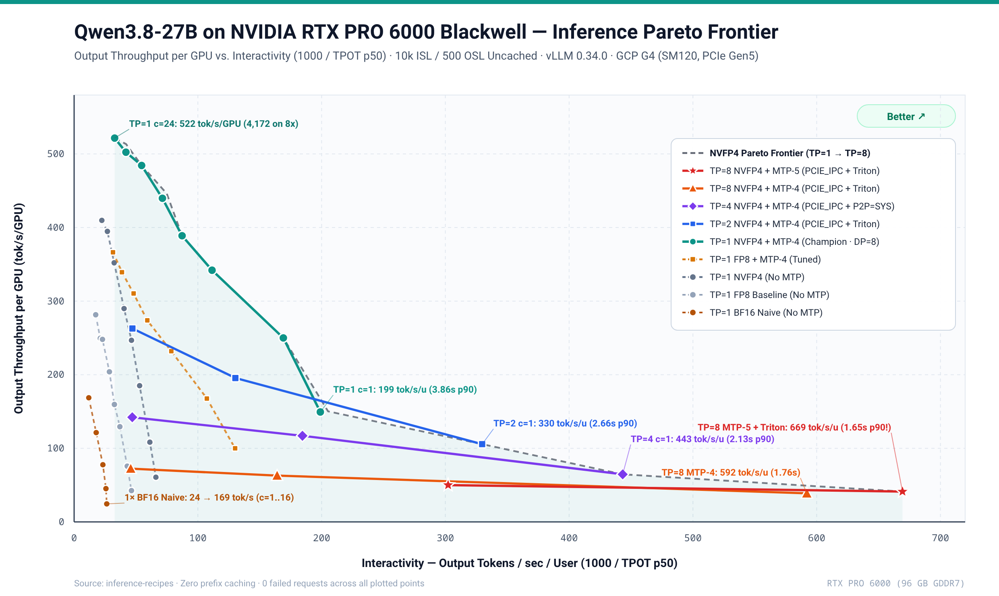
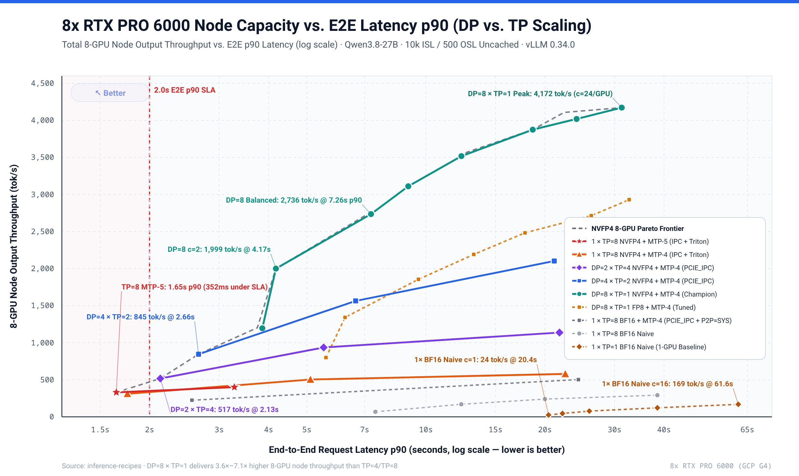
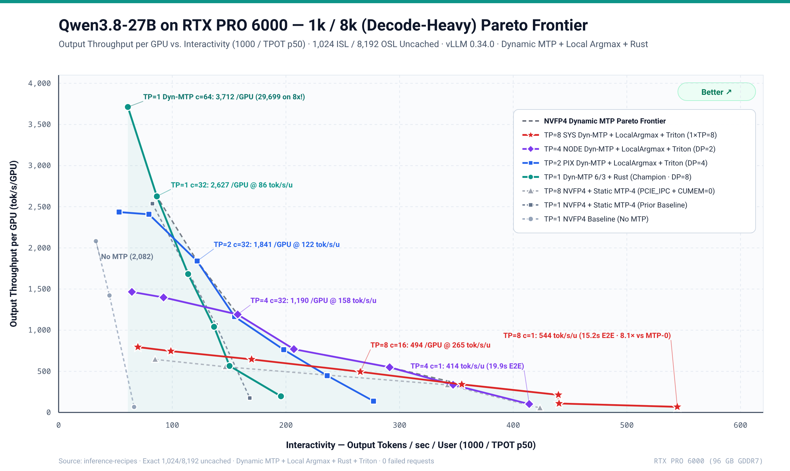
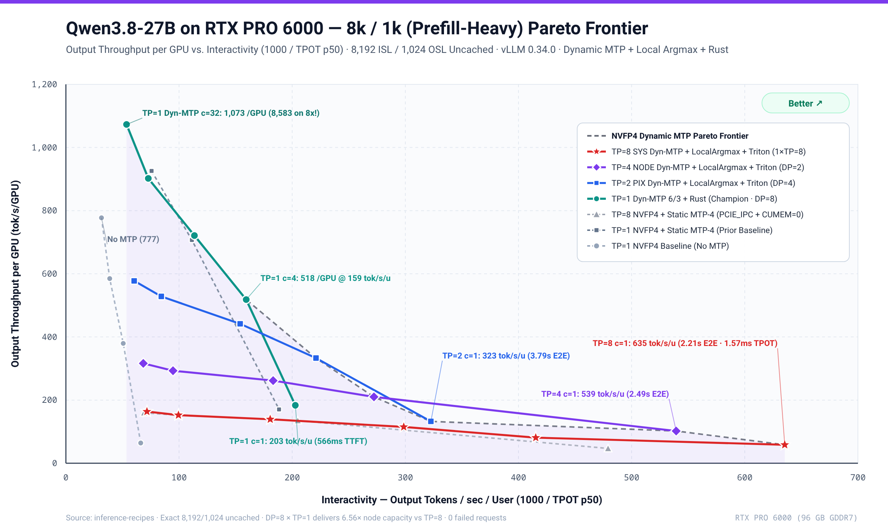
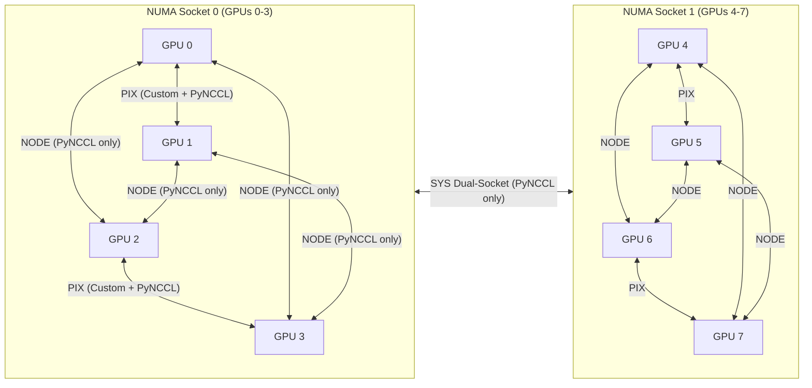

# Qwen3.8-27B on NVIDIA RTX PRO 6000 Blackwell — Hill-Climb & 8x Scaling Guide

> [!IMPORTANT]
> **Headline Result (`10,000` ISL / `500` OSL on NVIDIA RTX PRO 6000 Blackwell Server Edition)**:
> - **1x GPU Winner (`vLLM 0.34.0` + `nvidia/Qwen3.8-27B-NVFP4` + `MTP-4` + `--mamba-ssm-cache-dtype bfloat16` + `--max-num-batched-tokens 4096`)**: Delivers **6.10x faster single-stream speed than Native BF16** (`149.35` vs `24.49 out_tok/s`; **3.54x** over baseline `FP8` `42.23`), **5.29x lower E2E p90 vs Native BF16** (`3.86s` vs `20.42s` at `c=1`; **`4.17s` p90 at `c=2`**; **`7.26s` p90 at `c=4`**), and **`439.72–521.55 out_tok/s`** at `c=8..24`. Adding `VLLM_USE_BREAKABLE_CUDAGRAPH=0` + `torch.compile mode=3` pushes `1x` `c=16` further to **`513.36 out_tok/s`** (`22.35s` p90) and `c=1` to **`150.22 out_tok/s`** (`3.75s` p90), while omitting the `0.90` cap lets vLLM `0.34.0`'s **Extensible KV Cache** reclaim `7.82 GiB` for **`66.74x` (`1,093,391` tok)** per-GPU KV headroom (`533.9x` across `DP=8`).
> - **`1` GPU NVFP4 Still Beats `8` GPUs Native BF16 (Even With `PCIE_IPC + P2P=SYS`)**: A single tuned `NVFP4 + MTP-4` GPU (`502.40` default / **`513.36`** `mode=3` at `c=16`) outperforms all **8 GPUs running Naive BF16 `TP=8`** (`291.24`) by `1.76x` AND still edges out **8 GPUs running Tuned `BF16 + MTP-4 TP=8` with BOTH `NCCL_P2P_LEVEL=SYS` + `VLLM_ALLREDUCE_USE_FLASHINFER_PCIE_IPC=1`** (`502.17`).
> - **`1.65s` E2E p90 ACHIEVED Uncached Over PCIe Gen5 (`VLLM_ALLREDUCE_USE_FLASHINFER_PCIE_IPC=1` + `NCCL_P2P_LEVEL=SYS` + `qwen_g4_kernels` Triton `in_proj_ba`)**: Pairing `NCCL_P2P_LEVEL=SYS` (`38–40 GB/s` prefill P2P DMA) with FlashInfer's PCIe CUDA-IPC AllReduce (`VLLM_ALLREDUCE_USE_FLASHINFER_PCIE_IPC=1`) broke `< 2.0s` (`1.81s` p90, `305.39 tok/s`). Stacking the **`qwen_g4_kernels` skinny Triton GEMM plugin** for the `48` Gated DeltaNet `in_proj_ba` projections (`[12, 5120]` at `TP=8`) adds another **`+8.1%`** single-stream speedup (`-130` to `-160 ms`):
>   - **`TP=8` NVFP4 `MTP-5` + `qwen_g4_kernels` (`c=1`)**: **`330.03 out_tok/s`** (`4.54 tok/step`), `TTFT 748.7 / 750.1 ms`, `TPOT 1.49 / 1.80 ms`, **`E2E 1.494s p50 / 1.648s p90`** (**352 ms below `2.00s` p90**!).
>   - **`TP=8` NVFP4 `MTP-4` + `qwen_g4_kernels` (`c=1`)**: **`310.64 out_tok/s`**, `TTFT 748.3 / 749.3 ms`, `TPOT 1.69 / 2.02 ms`, **`E2E 1.592s p50 / 1.758s p90`** (`c=4`: `503.68 tok/s`; `c=16`: `578.90 tok/s`).
>   - **Bonus `1x` FP8 Win (`draft_lm_head_quantization: fp8` + `qwen_g4_kernels`)**: Lifts single-GPU FP8 `c=1` by **`+12.9%`** (`99.94 → 112.79 out_tok/s`) and cuts E2E p90 **`-12.1%`** (`5.59s → 4.91s`), breaking `< 5.0s` on 1 FP8 GPU (`59.85x` KV headroom).
> - **8x GPU Architecture Winner (`DP=8 × TP=1`)**: Even after `PCIE_IPC + P2P=SYS + qwen_g4_kernels` rescues `TP=4` (`1,137.2` node tok/s) and `TP=8` (`578.9`), Data Parallelism across 8 GPUs still dominates cluster capacity: **`2,735.8 out_tok/s`** at `c=4/GPU` (`7.26s` p90) and **`4,019.2 out_tok/s`** (`4,106.9` with `mode=3`) at `c=16/GPU` (`4,172.4` at `c=24/GPU`) — **`3.61x`** over `DP=2 × TP=4 IPC+SYS` and **`7.09x`** over `TP=8 IPC+SYS`.
> - **NEW — `1k/8k` (Decode-Heavy) & `8k/1k` (Prefill-Heavy) Dynamic MTP Hill-Climb (`237` verified runs, `5,782` requests, `0` failures)**: Stacking **Dynamic MTP** (`num_speculative_tokens_per_batch_size`: `K=6` at low batch → `K=3` at high batch), **`use_local_argmax_reduction=true`** (`+4.6%` to `+6.2%` on PCIe `TP=2/4/8` at `c=64`), **`VLLM_USE_RUST_FRONTEND=1`** (`vllm-rs`), **`NCCL_CUMEM_ENABLE=0`** (`-52%` CUDA Graph VRAM), and **`qwen_g4_kernels`** (`+10.2%` to `+15.2%` at `c=1` on `TP=4/8`) pushes **`TP=1` (`DP=8`)** to **`3,712 out_tok/s/GPU` (`29,699 node tok/s`)** on `1k/8k` (`+79.3%` over `MTP-0`) and **`1,073 out_tok/s/GPU` (`8,583 node tok/s`, `566 ms` TTFT)** on `8k/1k`, while **`TP=8`** reaches **`544 tok/s/user`** (`15.16s` E2E for 8,192 tokens, **`8.14x`** vs stock `TP=1`) on `1k/8k` and **`635 tok/s/user`** (`1.57 ms` TPOT, **`2.21s` E2E**) on `8k/1k` (see [Section 8](#8-1k8k-decode-heavy--8k1k-prefill-heavy-hill-climb-1--2--4--8-gpus)).

---


## Pareto Frontier Charts

### `10k / 500` (Long-Context Enterprise Reactivity)





### `1k / 8k` (Decode-Heavy Reasoning) & `8k / 1k` (Prefill-Heavy RAG)





*Charts are reproducibly generated from [`results/metrics.json`](results/metrics.json) and [`results/metrics_1k8k_8k1k.json`](results/metrics_1k8k_8k1k.json) via `python3 scripts/generate_charts.py`.*

## Quick-Pick Recipes

Runnable `serve.sh`, `deploy-gke.yaml`, and `metadata.yaml` bundles for each tier:

| Recipe | Topology | Quant & Stack | Best For |
|---|---|---|---|
| [`tp1-vllm-nvfp4-dyn-mtp`](recipes/tp1-vllm-nvfp4-dyn-mtp/) | `DP=8 × TP=1` | NVFP4 + **Dynamic MTP `6/3`** + **Rust frontend** + Extensible KV | **Max `1k/8k` & `8k/1k` throughput / `$/tok`** (`29,699 tok/s` node on `1k/8k`, `8,583 tok/s` on `8k/1k`) |
| [`tp2-vllm-nvfp4-dyn-mtp`](recipes/tp2-vllm-nvfp4-dyn-mtp/) | `DP=4 × TP=2` (`PIX`) | NVFP4 + **Dynamic MTP `6/4/3`** + **Local Argmax** + Rust + `PCIE_IPC` + `CUMEM=0` | **Balanced PCIe-switch `1k/8k` & `8k/1k`** (`277–332 tok/s/u` @ `c=1`, `19,492 tok/s` node) |
| [`tp4-vllm-nvfp4-dyn-mtp`](recipes/tp4-vllm-nvfp4-dyn-mtp/) | `DP=2 × TP=4` (`NODE`) | NVFP4 + **Dynamic MTP `6/4/3`** + **Local Argmax** + Rust + `PCIE_IPC` + `qwen_g4_kernels` | **Fast intra-socket reasoning/RAG** (`414–539 tok/s/u` @ `c=1`, `11,720 tok/s` node) |
| [`tp8-vllm-nvfp4-dyn-mtp`](recipes/tp8-vllm-nvfp4-dyn-mtp/) | `1 × TP=8` (`SYS`) | NVFP4 + **Dynamic MTP `6/4/3`** + **Local Argmax** + Rust + `PCIE_IPC` + `qwen_g4_kernels` | **Peak reasoning/RAG interactivity** (`544 tok/s/u` / `15.2s` on `1k/8k`, `635 tok/s/u` / `2.21s` on `8k/1k`) |
| [`tp1-vllm-nvfp4-mtp4`](recipes/tp1-vllm-nvfp4-mtp4/) | `DP=8 × TP=1` | NVFP4 + MTP-4 (`bf16` SSM, `bt=4096`) | **Default `10k/500` production** — balanced latency & cluster capacity (`4,019–4,172 tok/s` node) |
| [`tp1-vllm-nvfp4-mtp4-mode3`](recipes/tp1-vllm-nvfp4-mtp4-mode3/) | `DP=8 × TP=1` | NVFP4 + MTP-4 + `torch.compile mode=3` + Extensible KV | **Peak `10k/500` batch throughput & max KV headroom** (`4,107 tok/s` @ `c=16`, `533.9x` 16k slots) |
| [`tp1-vllm-fp8-mtp4`](recipes/tp1-vllm-fp8-mtp4/) | `DP=8 × TP=1` | FP8 + MTP-4 + FP8 draft `lm_head` + `qwen_g4_kernels` | **FP8 fallback** (`< 5.0s` E2E p90 on 1 GPU, `59.85x` KV headroom) |
| [`tp2-vllm-nvfp4-mtp4`](recipes/tp2-vllm-nvfp4-mtp4/) | `DP=4 × TP=2` (`PIX`) | NVFP4 + MTP-4 + `PCIE_IPC` + `P2P=SYS` | **Snappy `10k/500` interactive** (`2.62s` p90 @ `c=1`, `2,102 tok/s` node peak) |
| [`tp4-vllm-nvfp4-mtp4`](recipes/tp4-vllm-nvfp4-mtp4/) | `DP=2 × TP=4` | NVFP4 + MTP-4 + `PCIE_IPC` + `P2P=SYS` | **Ultra-low `10k/500` latency** (`2.13s` p90 @ `c=1`, `1,137 tok/s` node peak) |
| [`tp8-vllm-nvfp4-mtp4`](recipes/tp8-vllm-nvfp4-mtp4/) | `1 × TP=8` | NVFP4 + MTP-4 + `PCIE_IPC` + `P2P=SYS` + `qwen_g4_kernels` | **Strict `< 2.0s` `10k/500` p90** (`1.76s` p90 @ `c=1`, `310.6 tok/s`) |
| [`tp8-vllm-nvfp4-mtp5`](recipes/tp8-vllm-nvfp4-mtp5/) | `1 × TP=8` | NVFP4 + MTP-5 + `PCIE_IPC` + `P2P=SYS` + `qwen_g4_kernels` | **Fastest `10k/500` single-stream** (`1.65s` p90 @ `c=1`, `330.0 tok/s`) |

---

## 1. Executive Summary & Recommended Operating Tiers

For a high-reactivity `10,000`-token context / `500`-token output dense workload on the hybrid Gated DeltaNet (GDN/Mamba) + attention `Qwen3.8-27B` architecture, moving from naive `FP8` serving to tuned `NVFP4 + MTP` fundamentally shifts the latency-throughput frontier on `SM120` Blackwell GPUs.

### Recommended Production Operating Tiers

| SLA / Reactivity Tier | Topology & Engine Config | Concurrent / RPS Target | `out_tok/s` (Replica / Node) | TTFT p50 / p90 (ms) | TPOT p50 / p90 (ms) | E2E p50 / p90 (s) |
| :--- | :--- | :--- | :--- | :--- | :--- | :--- |
| **Tier 0a: Strict `< 2.0s` p90 Uncached** | **`1 × TP=8`, NVFP4 + `MTP-5` (`MTP-4` opt.) + `PCIE_IPC` + `P2P=SYS` + `qwen_g4_kernels`** | `c=1` (`1` total) | `330.03` / **`330.0`** *(MTP-4: `310.6`)* | `748.7 / 750.1` | `1.49 / 1.80` | **`1.49 / 1.65`** *(MTP-4: **`1.59 / 1.76`**)* |
| **Tier 0b: Ultra-Low-Latency (`~2.1s p90`)** | **`DP=2 × TP=4`, NVFP4 + MTP-4 + `PCIE_IPC` + `P2P=SYS`** | `c=1/rep` (`2` total) | `258.63` / **`517.3`** | `748.8 / 761.0` | `2.26 / 2.77` | **`1.88 / 2.13`** |
| **Tier 1: Sub-2.7s Snappy (`4x` Density)** | **`DP=4 × TP=2` (`PIX`), NVFP4 + MTP-4 + `PCIE_IPC` (+ Triton opt.)** | `c=1/rep` (`4` total) | `211.21` / **`844.8`** *(stock: `828.4`)* | `774.8 / 775.1` | `3.03 / 3.78` | **`2.29 / 2.66`** *(stock: `2.36 / 2.62`)* |
| **Tier 2: Low-Latency Interactive (`1x` GPU)** | **`DP=8 × TP=1`, NVFP4 + MTP-4 (`mode=3` opt.)** | `c=2/GPU` (`16` total) | `249.91` / **`1,999.3`** | `899.1 / 1402.7` | `5.92 / 6.80` | **`3.88 / 4.17`** |
| **Tier 3: Balanced High-Reactivity (Default)** | **`DP=8 × TP=1`, NVFP4 + MTP-4 (`MTP-5` opt.)** | `0.45 RPS/GPU` (`3.6` node RPS) | `199.98` / **`1,599.8`** | `886.3 / 1435.7` | `7.10 / 11.55` | **`4.74 / 7.11`** *(MTP-5: `4.50 / 6.82`)* |
| **Tier 3b: Closed-Loop Balanced** | **`DP=8 × TP=1`, NVFP4 + MTP-4 (`MTP-5` opt.)** | `c=4/GPU` (`32` total) | `341.97` / **`2,735.8`** | `871.0 / 2051.3` | `8.97 / 11.54` | **`5.54 / 7.26`** *(MTP-5: `5.89 / 6.97`)* |
| **Tier 4: High-Throughput Interactive** | **`DP=8 × TP=1`, NVFP4 + MTP-4 (`mode=3` opt.)** | `c=8/GPU` (`64` total) | `446.18` / **`3,569.4`** | `1524.4 / 4627.8` | `13.36 / 16.39` | **`8.17 / 12.69`** *(default: `439.7` / `12.30s`)* |
| **Tier 5: Peak Batch / Capacity** | **`DP=8 × TP=1`, NVFP4 + MTP-4 (`mode=3`, Extensible KV `66.74x`)** | `c=16/GPU` (`128` total) | `513.36` / **`4,106.9`** | `2630.5 / 9712.9` | `23.81 / 28.14` | **`15.16 / 22.35`** *(default: `4,019.2` / `24.05s`)* |

> [!TIP]
> **MTP-4 vs MTP-5 Choice**: Use **`num_speculative_tokens: 4`** as the general production default (higher KV concurrency headroom `61.26x` vs `56.35x`, best `c=2` and `c=12` throughput). Switch to **`num_speculative_tokens: 5`** only when open-loop arrival rates stay in **`0.45–0.65 RPS/GPU` (`c=4..6`)**, where higher draft acceptance (`4.47–4.49 tok/step`) trims Poisson E2E p90 by `-4%` to `-8%` (`6.82s` vs `7.11s` at `0.45 RPS`, `11.62s` vs `12.68s` at `0.65 RPS`).

---

## 2. Hardware Topology & Benchmark Methodology

### Node & GPU Architecture
All runs executed on an 8-GPU GCP G4 GKE node (`g4-standard-384`, 384 vCPUs, 1.5 TiB RAM, Container-Optimized OS):
- **Accelerators**: `8x NVIDIA RTX PRO 6000 Blackwell Server Edition` (`94.97 GiB` allocatable VRAM per GPU, `SM120`, GDDR7).
- **Interconnect**: PCIe Gen5 without NVLink. `nvidia-smi topo -m` confirmed asymmetric dual-socket PCIe layout:
  - **NUMA Socket 0 (GPUs 0–3)**: `(0,1)` and `(2,3)` connected via `PIX` (single PCIe bridge); cross-pair `(0,2)/(1,3)` connected via `NODE` (PCIe host bridge).
  - **NUMA Socket 1 (GPUs 4–7)**: Symmetric local PCIe layout on Socket 1.
  - **Cross-Socket (GPUs 0–3 ↔ GPUs 4–7)**: Connected via `SYS` (QPI/UPI host interconnect).



### Workload & Measurement Protocol
To reflect high-reactivity enterprise production traffic fairly without synthetic inflated numbers:
- **Dataset ([`bench/scripts/make_dataset.py`](../../../bench/scripts/make_dataset.py))**: 128 unique synthetic enterprise customer-escalation packets (multi-channel ticket turns, CRM/webhook audit traces, SLA policy clauses), each verified to tokenize to **exact `10,000` input tokens** (`add_special_tokens=False`). Across all 254 timed benchmark executions (`4,884` requests, `61` server logs), measured `mean_prompt_tokens` was uniformly `10,000`.
- **Decode Target ([`bench/scripts/bench_client.py`](../../../bench/scripts/bench_client.py))**: OpenAI streaming `/v1/completions` with `max_tokens=500`, `ignore_eos=True`, `temperature=0.0`, `stream=True`, guaranteeing **exact `500` completion tokens** (`mean=500`, `min=500`, `max=500`) across every request.
- **Zero Prefix Cache Cheat**: Both engines ran with prefix/radix caching explicitly disabled (`--no-enable-prefix-caching` on vLLM, `--disable-radix-cache` on SGLang) so every request paid the full 10k-token prefill cost.
- **FP8 KV Cache**: Both engines used FP8 E4M3 KV cache (`--kv-cache-dtype fp8` on vLLM, `--kv-cache-dtype fp8_e4m3` on SGLang) and `--max-model-len 16384`.
- **Warmup & Telemetry**: Each concurrency/RPS run executed dedicated un-timed warmup requests first, then collected client SSE timestamps (`TTFT`, `TPOT = (E2E - TTFT) / 499`, `E2E`, `ITL`) alongside Prometheus `/metrics` counter deltas (`vllm:spec_decode_num_*` / `sglang:spec_accept_length`). **Zero failed requests** occurred across all 254 timed benchmark JSONs (`4,884` completed requests, `0` failed).
- **Containers**: `vllm/vllm-openai:v0.34.0` and `lmsysorg/sglang:v0.5.23-cu130`.

---

## 3. Stage 1: Serving Engine (`SGLang` vs `vLLM`) & Quantization (`FP8` vs `NVFP4`)

First, we evaluated `SGLang 0.5.23` (`S1–S4`) vs `vLLM 0.34.0` (`V1–V4`) head-to-head on `1x RTX PRO 6000` across `Qwen/Qwen3.8-27B-FP8` and `nvidia/Qwen3.8-27B-NVFP4`, both unspeculated and with `MTP-3`.

| Cell | Engine & Version | Model | Spec Decode | `c=1` `out_tok/s` (E2E p90) | `c=4` `out_tok/s` (E2E p90) | `c=8` `out_tok/s` (E2E p90) | KV Cache Capacity (`16k` slots) |
| :--- | :--- | :--- | :--- | :--- | :--- | :--- | :--- |
| **`S1`** | `SGLang 0.5.23` | `FP8` | None | `41.42` (`12.08s`) | `125.98` (`15.88s`) | `194.60` (`20.56s`) | `1,188,765` tok (`72.6x`) |
| **`V1`** | `vLLM 0.34.0` | `FP8` | None | `42.23` (`11.84s`) | `126.76` (`15.89s`) | `197.75` (`23.39s`) | `1,212,416` tok (`74.0x`) |
| **`S2`** | `SGLang 0.5.23` | `FP8` | `MTP-3` (`EAGLE`) | `94.65` (`5.38s`) | `211.54` (`10.93s`) | `279.31` (`19.43s`) | `459,783` tok (`28.1x`) |
| **`V2`** | `vLLM 0.34.0` | `FP8` | `MTP-3` | `97.31` (`5.28s`) | `222.81` (`10.12s`) | `298.10` (`19.08s`) | `705,936` tok (`43.1x`) |
| **`S3`** | `SGLang 0.5.23` | `NVFP4` | None | `60.28` (`8.30s`) | `168.87` (`11.84s`) | `262.89` (`15.22s`) | `1,372,399` tok (`83.8x`) |
| **`V3`** | `vLLM 0.34.0` | `NVFP4` | None | `59.89` (`8.35s`) | `179.54` (`11.18s`) | `279.35` (`16.37s`) | `1,473,389` tok (`89.9x`) |
| **`S4`** | `SGLang 0.5.23` | `NVFP4` | `MTP-3` (`EAGLE`) | `122.47` (`4.46s`) | `280.62` (`8.55s`) | `374.37` (`13.85s`) | `721,415` tok (`44.0x`) |
| **`V4`** | `vLLM 0.34.0` | `NVFP4` | `MTP-3` | **`129.84` (`4.15s`)** | **`321.09` (`7.27s`)** | **`417.33` (`13.36s`)** | `804,240` tok (`49.1x`) |

### Key Stage 1 Engineering Findings
1. **Parity Without MTP (`~1–2%`), Clear vLLM Lead With NVFP4 + MTP (`+6%` to `+14.4%`)**: Without speculative decoding on `FP8`, SGLang and vLLM perform within `2%`. Once combining `NVFP4` (`FlashInferCutlassNvFp4LinearKernel` via FlashInfer `CutlassFp4GemmRunner` on SM120) with `MTP-3`, vLLM pulls ahead by **`+14.4%` at `c=4`** (`321.09` vs `280.62 out_tok/s`) and **`+11.5%` at `c=8`** (`417.33` vs `374.37`).
2. **Speculative Hybrid Mamba/GDN Concurrency Overhead**: Enabling MTP allocates per-draft-step Mamba/GDN recurrent state slots alongside paged KV blocks. SGLang defaulted to capping `--max-running-requests` at `48` with `MTP` (`available_gpu_mem` tightened to `10.63 GB`), whereas vLLM cleanly ran `--max-num-seqs 256` with Breakable CUDA Graphs (`VLLM_USE_BREAKABLE_CUDAGRAPH=1`) and FlashInfer XQA decode.
3. **NVFP4 Prefill & Decode Uplift**: On `V3` vs `V1` (`c=1`), `NVFP4` cut weights memory from `27.55 GiB` to `18.96 GiB`, dropped `10k` prefill TTFT p50 from **`995.4 ms` → `676.2 ms` (`-32%`)**, and raised baseline decode throughput from `42.23` → `59.89 out_tok/s` (`+41.8%`). With MTP (`V4` vs `V2`), `NVFP4` further amplified draft+verify throughput by **`+33.4%` (`c=1`)** and **`+40.0%` (`c=8`)**.

---

## 4. Stage 2: Single-Variable Hill-Climb Ablations (`1x` GPU)

Using `V4` (`vLLM 0.34.0` + `nvidia/Qwen3.8-27B-NVFP4` + `--max-num-seqs 256`) as our base rung, we isolated one variable per step across `c=1, 4, 8, 12`.

### Rung A: MTP Speculative Depth (`0, 2, 3, 4, 5`)

| Run ID | MTP Depth | `16k` KV Slots | `c=1` `out/s` (`tok/step`) | `c=4` `out/s` (`tok/step`) | `c=8` `out/s` (`tok/step`) | `c=12` `out/s` (`tok/step`) | `c=1` / `c=4` E2E p90 |
| :--- | :--- | :--- | :--- | :--- | :--- | :--- | :--- |
| **`V3`** | `0` (None) | `89.93x` | `59.89` (`1.00`) | `179.54` (`1.00`) | `279.35` (`1.00`) | `352.10` (`1.00` via `v3_ext`) | `8.35s` / `11.18s` |
| **`rA1`** | `MTP-2` | `57.10x` | `116.10` (`2.62`) | `304.57` (`2.75`) | `393.80` (`2.66`) | `437.57` (`2.68`) | `4.54s` / `7.47s` |
| **`V4`** | `MTP-3` | `49.09x` | `129.84` (`3.22`) | `321.09` (`3.36`) | `417.33` (`3.37`) | — | `4.15s` / `7.27s` |
| **`rA2`** | **`MTP-4`** | `43.84x` | `149.95` (`3.99`) | `326.47` (`3.86`) | `433.88` (`4.09`) | **`481.60` (`4.23`)** | `3.60s` / `7.30s` |
| **`rA3`** | **`MTP-5`** | `39.14x` | **`155.78` (`4.50`)** | **`348.30` (`4.74`)** | **`435.80` (`4.56`)** | `454.19` (`4.25`) | **`3.56s` / `6.69s`** |

- **Takeaway**: Moving `MTP-3 → MTP-4` unlocked **`+15.5%` at `c=1`** (`129.84 → 149.95 out_tok/s`) and raised mean step yield to **`3.86–4.23 tok/step`**. Moving further to `MTP-5` boosted `c=1..4` (`348.30 out_tok/s`, `4.74 tok/step`!), but **regressed at `c=12` (`454.19` vs `481.60 out_tok/s`)** because verifying 6 candidate tokens per request at higher batch sizes increases target-model compute pressure and KV cache block consumption (`39.14x` vs `43.84x` max `16k` slots).

---

### Rung B: Hybrid GDN/Mamba SSM State Cache Dtype (`float32` vs `bfloat16`)

`Qwen3.8-27B` checkpoints specify `mamba_ssm_dtype: "float32"` in config. Keeping FP32 Mamba state padded attention block size to `1,600` (`V4` MTP-3) and `1,664` (`rA2` MTP-4, `43.84x` 16k capacity). Passing `--mamba-ssm-cache-dtype bfloat16` cut the GDN recurrent footprint in half, allowing vLLM to shrink attention block size to **`896` tokens**.

| Run ID | SSM State Dtype | Attn Block Size | GPU KV Cache (`16k` Slots) | `c=1` `out/s` (`tok/step`) | `c=4` `out/s` (`tok/step`) | `c=8` `out/s` (`tok/step`) | `c=12` `out/s` (`tok/step`) |
| :--- | :--- | :--- | :--- | :--- | :--- | :--- | :--- |
| **`rA2`** | `float32` (default) | `1,600` tok | `718,274` (`43.84x`) | `149.95` (`3.99`) | `326.47` (`3.86`) | `433.88` (`4.09`) | `481.60` (`4.23`) |
| **`rB1`** | **`bfloat16`** | **`896` tok** | **`980,630` (`59.85x`)** | `149.19` (`3.90`) | **`341.27` (`4.05`)** | **`444.25` (`4.03`)** | **`481.88` (`3.82`)** |

- **Takeaway**: `--mamba-ssm-cache-dtype bfloat16` delivered **`+36.5%` more usable KV capacity** (`43.84x → 59.85x`) and **`+4.5%` throughput at `c=4`** (`341.27` vs `326.47 out_tok/s`) with **zero degradation in MTP acceptance** (`4.05` vs `3.86 tok/step` at `c=4`, `4.03` vs `4.09` at `c=8`).

---

### Rung C: Prefill-Decode Interleaving (`--max-num-batched-tokens`)

Chunked prefill budget directly controls TTFT tail spikes vs active decode stalls when `10,000`-token requests arrive concurrently.

| Run ID | `--max-num-batched-tokens` | `16k` KV Slots | `c=1` `out/s` (E2E p90) | `c=4` `out/s` (TTFT p90 / E2E p90) | `c=8` `out/s` (TTFT p90 / E2E p90) | `c=12` `out/s` (TTFT p50 / E2E p90) |
| :--- | :--- | :--- | :--- | :--- | :--- | :--- |
| **`rC1`** | `16384` | `56.35x` | `151.12` (`3.56s`) | `332.89` (`2826.5ms` / `7.15s`) | `433.56` (`5350.4ms` / `12.49s`) | `481.86` (`2233.8ms` / `18.15s`) |
| **`rB1`** | Default (`8192`) | `59.85x` | `149.19` (`3.70s`) | `341.27` (`2293.0ms` / `7.17s`) | `444.25` (`5173.9ms` / `12.04s`) | `481.88` (`1971.8ms` / `18.30s`) |
| **`rC2`** | **`4096` (Winner)** | **`61.26x`** | **`151.68` (`3.66s`)** | **`341.98` (`2048.9ms` / `7.26s`)** | `439.76` (**`4428.0ms`** / `12.30s`) | **`484.37` (`1590.6ms` / `18.63s`)** |
| **`rC3`** | `2048` | `61.53x` | `149.54` (`3.85s`) | `340.61` (`1979.7ms` / `6.84s`) | `443.79` (`4485.2ms` / `11.83s`) | `481.24` (**`3177.4ms`**, Queue delay) |

- **Takeaway**:
  - `16384` (`rC1`) lets a single `10k` prompt monopolize an entire forward pass (`> 10,000` tokens), stalling active decode batches and hurting `c=4` TTFT p90 (`2.83s` vs `2.05s`).
  - `2048` (`rC3`) forces five prefill chunks per `10k` request, doubling `c=12` median TTFT (`3.18s` vs `1.59s`).
  - **`4096` (`rC2`)** achieves the cleanest Pareto knee: **lowest `c=12` median TTFT (`1.59s`)**, **lowest `c=8` TTFT p90 (`4.43s`)**, and **peak `c=12` throughput (`484.37 out_tok/s`)**.

---

### Rung D1: Checkpoint & `lm_head` Quantization Variants (`bf16_ssm` + `MTP-4`)

Even with dense weights in NVFP4, the `Qwen3.8` vocabulary (`248,320 × 2,560`) and speculative verification steps make `lm_head` projection memory-bandwidth critical. We compared `nvidia/Qwen3.8-27B-NVFP4` (quantized head) against `RadixArk/Qwen3.8-27B-NVFP4-BF16-LMHead` (BF16 head) and `unsloth/Qwen3.8-27B-NVFP4` (`CutlassFP8ScaledMM` mixed FP8 tail/head).

| Run ID | Checkpoint | Weights Mem | `c=1` `out/s` (`tok/step`) | `c=4` `out/s` (`tok/step`) | `c=8` `out/s` (`tok/step`) | `c=12` `out/s` (`tok/step`) |
| :--- | :--- | :--- | :--- | :--- | :--- | :--- |
| **`rB1`** | **`nvidia/Qwen3.8-27B-NVFP4`** | **`19.75 GiB`** | **`149.19`** (`3.90`) | **`341.27`** (`4.05`) | **`444.25`** (`4.03`) | **`481.88`** (`3.82`) |
| **`rD1`** | `RadixArk/...-BF16-LMHead` | `21.45 GiB` | `132.77` (`4.38`) | `313.91` (`4.26`) | `408.75` (`4.16`) | `453.23` (`4.06`) |
| **`rD1b`** | `unsloth/Qwen3.8-27B-NVFP4` | `21.14 GiB` | `142.89` (`4.31`) | `319.17` (`4.20`) | `408.98` (`3.99`) | `455.28` (`4.13`) |

- **Takeaway (Bandwidth Beats Higher Acceptance)**: `RadixArk` achieved up to `+0.48` higher tokens/step (`4.38` vs `3.90` at `c=1`), proving BF16 `lm_head` improves logit fidelity. However, **`nvidia/Qwen3.8-27B-NVFP4` was `+12.4%` (`c=1`), `+8.7%` (`c=4/8`), and `+6.3%` (`c=12`) faster net `out_tok/s`** because each MTP-4 verification pass reads `lm_head` for 5 token positions per sequence — reading an FP4/compact head consumes far less GDDR7 bandwidth than a 16-bit (`21.45 GiB` total model vs `19.75 GiB`) or FP8 (`21.14 GiB`) head.

---

### Rung D2: Bonus Speculator — `SGLang 0.5.23` + `incoai/Qwen3.8-27B-DFlash2` (`NVFP4`)

We tested the external block-diffusion draft checkpoint `incoai/Qwen3.8-27B-DFlash2` (`DFLASH`, `speculative_num_draft_tokens=8`, `mamba_ssm_dtype=bfloat16`, `KV=664,989 tokens`) against tuned native `vLLM MTP-4` and `MTP-5`.

| Concurrency | `SGLang DFlash2` (`out/s` / E2E p90) | `vLLM MTP-4 Tuned` (`out/s` / E2E p90) | `vLLM MTP-5 Tuned` (`out/s` / E2E p90) | `vLLM MTP-4` vs `DFlash2` |
| :--- | :--- | :--- | :--- | :--- |
| **`c=1`** | `144.20` (`3.801s`) | **`149.35`** (`3.856s`) | `149.22` (`3.794s`) | **`+3.6%`** |
| **`c=2`** | `222.53` (`5.217s`) | **`249.91`** (`4.174s`) | `240.89` (`4.589s`) | **`+12.3%`** |
| **`c=4`** | `309.42` (`7.906s`) | **`341.97`** (`7.262s`) | `341.14` (`6.971s`) | **`+10.5%`** |
| **`c=6`** | `351.83` (`10.938s`) | `388.82` (`9.021s`) | **`401.15`** (`9.952s`) | **`+10.5%`** *(MTP-5 `+14.0%`)* |
| **`c=8`** | `382.82` (`13.638s`) | `439.72` (`12.297s`) | **`440.26`** (`12.038s`) | **`+14.9%`** |
| **`c=12`** | `424.87` (`19.275s`) | **`484.31`** (`18.629s`) | `470.10` (`19.243s`) | **`+14.0%`** |

- **Takeaway**: `vLLM 0.34.0 + native MTP-4` outperforms `SGLang + DFlash2` at every concurrency (`+3.6%` to `+14.9%`) with lower operational complexity (no separate draft HF repo) and `51%` larger KV cache pool (`1,003,760` vs `664,989` tokens).

---

## 5. Stage 3: Full `1x` RTX PRO 6000 Pareto & Poisson Arrival Curves

### Closed-Loop Concurrency Sweep (`c = 1` to `24`)

#### 5a. Champion Stack: `final_vllm_nvfp4_mtp4_tuned` (`nvidia/Qwen3.8-27B-NVFP4`, `MTP-4`, `bfloat16` SSM, `bt=4096`, `KV=1,003,760` / `61.26x`)

| Load | `ok` | `out_tok/s` | `total_tok/s` | `req/s` | TTFT p50 / p90 (ms) | TPOT p50 / p90 (ms) | E2E p50 / p90 (s) | Mean `tok/step` |
| :--- | :--- | :--- | :--- | :--- | :--- | :--- | :--- | :--- |
| **`c=1`** | `10/10` | `149.35` | `3,136.28` | `0.299` | `718.1 / 719.5` | `5.03 / 6.29` | `3.221 / 3.856` | `3.90` |
| **`c=2`** | `12/12` | `249.91` | `5,248.08` | `0.500` | `899.1 / 1402.7` | `5.92 / 6.80` | `3.877 / 4.174` | `4.16` |
| **`c=4`** | `16/16` | `341.97` | `7,181.28` | `0.684` | `871.0 / 2051.3` | `8.97 / 11.54` | `5.535 / 7.262` | `4.05` |
| **`c=6`** | `20/20` | `388.82` | `8,165.23` | `0.778` | `1083.8 / 3186.9` | `11.46 / 13.12` | `7.008 / 9.021` | `4.06` |
| **`c=8`** | `24/24` | `439.72` | `9,234.19` | `0.879` | `1009.5 / 4429.7` | `14.01 / 17.63` | `8.346 / 12.297` | `4.02` |
| **`c=12`** | `24/24` | `484.31` | `10,170.52` | `0.969` | `1591.1 / 7482.3` | `18.32 / 25.48` | `11.774 / 18.629` | `3.94` |
| **`c=16`** | `32/32` | `502.40` | `10,550.38` | `1.005` | `2367.8 / 9760.7` | `23.89 / 29.17` | `14.949 / 24.050` | `3.95` |
| **`c=24`** | `36/36` | **`521.55`** | **`10,952.47`** | **`1.043`** | `5090.9 / 15677.3` | `30.52 / 43.63` | `24.519 / 31.279` | `3.88` |

#### 5b. High-Reactivity Variant (`MTP-5` Tuned) & Full Reference Baselines

| Config | `c=1` `out/s` (E2E p90) | `c=2` `out/s` (E2E p90) | `c=4` `out/s` (E2E p90) | `c=6` `out/s` (E2E p90) | `c=8` `out/s` (E2E p90) | `c=12` `out/s` (E2E p90) | `c=16` `out/s` (E2E p90) | `c=24` `out/s` (E2E p90) |
| :--- | :--- | :--- | :--- | :--- | :--- | :--- | :--- | :--- |
| **`NVFP4 + MTP-4` (Winner)** | `149.35` (`3.86s`) | **`249.91` (`4.17s`)** | **`341.97`** (`7.26s`) | `388.82` (**`9.02s`**) | `439.72` (`12.30s`) | **`484.31` (`18.63s`)** | **`502.40` (`24.05s`)** | **`521.55` (`31.28s`)** |
| **`NVFP4 + MTP-5` Tuned** | `149.22` (**`3.79s`**) | `240.89` (`4.59s`) | `341.14` (**`6.97s`**) | **`401.15`** (`9.95s`) | **`440.26` (`12.04s`)** | `470.10` (`19.24s`) | — | — |
| **`FP8 + MTP-4` Tuned** | `99.94` (`5.59s`) | `167.60` (`6.24s`) | `231.92` (`9.58s`) | `273.82` (`13.21s`) | `310.35` (`17.81s`) | `339.33` (`26.19s`) | `366.26` (`32.67s`) | — |
| **`NVFP4` No MTP (`v3_ext`)** | `60.75` (`8.23s`) | `108.36` (`9.23s`) | `185.10` (`11.38s`) | `246.74` (`13.75s`) | `289.84` (`16.32s`) | `352.10` (`22.05s`) | `394.70` (`27.30s`) | `409.74` (`34.98s`) |
| **`FP8` No MTP (`v1_ext`)** | `42.54` (`11.76s`) | `75.68` (`13.22s`) | `129.38` (`16.16s`) | `159.54` (`19.97s`) | `203.95` (`23.29s`) | `248.01` (`31.53s`) | `249.53` (`36.26s`) | `281.47` (`45.44s`) |

Across equal tuned settings (`c=1..12`), **`NVFP4 + MTP-4` delivers `1.42x–1.49x` higher throughput than `FP8 + MTP-4`** while reducing `c=1` TTFT p90 from `1,039.6 ms` to `719.5 ms` (`-30.8%`).

### Open-Loop Poisson Arrival Sweep (`1x` RTX PRO 6000)

To verify real-world queuing behavior under random Poisson arrivals (without closed-loop synchronization artifacts):

| Config | Target Rate | `ok` | Achieved `out_tok/s` (`req/s`) | TTFT p50 / p90 (ms) | TPOT p50 / p90 (ms) | E2E p50 / p90 (s) | Mean `tok/step` |
| :--- | :--- | :--- | :--- | :--- | :--- | :--- | :--- |
| **`MTP-4` Tuned** | `0.25 RPS` | `24/24` | `99.92` (`0.200`) | `787.1 / 1049.9` | `6.21 / 8.42` | `3.849 / 5.302` | `3.90` |
| **`MTP-5` Tuned** | `0.25 RPS` | `24/24` | `99.18` (`0.198`) | `801.7 / 1070.7` | `6.00 / 9.05` | **`3.770`** / `5.433` | `4.10` |
| **`MTP-4` Tuned** | `0.45 RPS` | `32/32` | `199.98` (`0.400`) | **`886.3 / 1435.7`** | `7.10 / 11.55` | `4.741 / 7.113` | `3.97` |
| **`MTP-5` Tuned** | `0.45 RPS` | `32/32` | `199.42` (`0.399`) | `891.5 / 1446.1` | **`6.84 / 11.08`** | **`4.504 / 6.823`** | `4.49` |
| **`MTP-4` Tuned** | `0.65 RPS` | `36/36` | `296.79` (`0.594`) | **`1100.3`** / `2229.6` | `9.85 / 22.60` | `6.674 / 12.675` | `3.93` |
| **`MTP-5` Tuned** | `0.65 RPS` | `36/36` | `295.37` (`0.591`) | `1103.1 / 2119.2` | **`8.89 / 20.28`** | **`6.109 / 11.619`** | `4.47` |
| **`MTP-4` Tuned** | `0.80 RPS` | `40/40` | `364.01` (`0.728`) | `1202.9 / 2435.5` | `12.70 / 27.93` | `7.761 / 15.773` | `3.95` |

- **Queuing Knee**: Up to **`0.45 RPS/GPU`** (`~3.6 RPS` on an 8-GPU node), queues stay shallow (`TTFT p90 ~1.44s`, `E2E p90 ~6.8–7.1s`). Beyond `0.65 RPS/GPU`, queue buildup pushes TPOT/E2E p90 steeply upward toward saturation (~`1.04 req/s` max closed-loop service rate).

---

## 6. Stage 4: `8x` RTX PRO 6000 Multi-GPU Scaling & `< 2s` E2E Feasibility

We benchmarked `TP=2` (CUDA GPUs `0,1` over a single `PIX` bridge), `TP=4` (CUDA GPUs `0,1,2,3` on Socket 0 `PIX+NODE`), `TP=4 + MTP-5` (`c=1` latency floor check), and `TP=8` (all 8 GPUs across `SYS`), comparing single-replica performance and total 8-GPU node capacity.

### Per-Replica & 8-GPU Node Scaling Table (`nvidia/Qwen3.8-27B-NVFP4`, `bf16` SSM, `bt=4096`, Default Unset `NCCL_P2P_LEVEL`)

| Concurrency / Replica | `TP=1` (`DP=8 × TP=1`) `out/s` (E2E p90) | `TP=2 PIX` (`DP=4 × TP=2`) `out/s` (E2E p90) | `TP=4` (`DP=2 × TP=4`) `out/s` (E2E p90) | `TP=8` (`1 × TP=8`) `out/s` (E2E p90) | **`DP=8` Node Total** (`8× TP=1`) | **`DP=4 × TP=2` Node Total** | **`DP=2 × TP=4` Node Total** |
| :--- | :--- | :--- | :--- | :--- | :--- | :--- | :--- |
| **`c=1`** | `149.35` (`3.856s`) | `200.17` (`2.720s`) | **`203.44` (`2.669s`)** | `173.49` (`3.042s`) | **`1,194.8`** | `800.7` | `406.9` |
| **`c=2`** | `249.91` (`4.174s`) | **`293.88`** (`4.270s`) | `272.50` (`3.909s`) | `240.14` (`5.243s`) | **`1,999.3`** | `1,175.5` | `545.0` |
| **`c=4`** | `341.97` (`7.262s`) | **`389.71` (`6.620s`)** | `342.92` (`7.314s`) | `291.50` (`8.278s`) | **`2,735.8`** | `1,558.8` | `685.8` |
| **`c=8`** | `439.72` (`12.297s`) | **`478.63` (`11.683s`)** | `389.46` (`15.538s`) | `330.70` (`16.941s`) | **`3,517.8`** | `1,914.5` | `778.9` |
| **`c=16`** | `502.40` (`24.050s`) | **`520.57` (`22.442s`)** | `409.12` (`31.421s`) | `374.58` (`33.416s`) | **`4,019.2`** | `2,082.3` | `818.2` |
| **`c=32`** | — *(c=24: `521.55`)* | — | `430.91` (`44.530s`) | `382.27` (`49.882s`) | *(`DP=8 @ c=24`: `4,172.4`)* | — | `861.8` |

> [!WARNING]
> **Why `TP=4` & `TP=8` Underperform `TP=2` (`PIX`) and Even `TP=1` Out-of-the-Box**:
> 1. **All-Reduce Transport Downgrade**: Server logs confirm that **`TP=2` (`PIX`) uses `['CUSTOM', 'PYNCCL']` P2P shared-memory custom all-reduce**, whereas on **`TP=4` and `TP=8`** vLLM prints `WARNING: Custom allreduce is disabled because it's not supported on more than two PCIe-only GPUs` and falls back to **`['PYNCCL']` over PCIe `NODE`/`SYS`** — which furthermore drops to CPU `SHM` staging unless `NCCL_P2P_LEVEL=SYS` is exported (see **Stage 4c** below).
> 2. **Latency Impact**: Two all-reduces per transformer layer multiplied across MTP draft/verify passes turn PCIe latency into the dominant bottleneck. Consequently, without `NCCL_P2P_LEVEL=SYS`, **`1x TP=1` (`439.72` at `c=8`, `502.40` at `c=16`) beats a single `TP=4` (`389.46` / `409.12`) AND `TP=8` (`330.70` / `374.58`) replica outright**! *(See **Stage 4c** for the `+21.9%` to `+57.7%` rescue when setting `NCCL_P2P_LEVEL=SYS`, where `DP=8 × TP=1` still wins 8-GPU node throughput by `3.66x–7.17x`.)*

### Stage 4b: Native Checkpoint (`Qwen/Qwen3.8-27B` BF16) & `FP8` Extension (`1 / 2 / 4 / 8` Chips)

To quantify the full impact of native vs quantized checkpoints across multi-GPU topologies, we repeated the `TP=1, 2, 4, 8` sweep on:
1. **`bf16_naive`** (`Qwen/Qwen3.8-27B`, no MTP, BF16 KV cache, `float32` SSM state)
2. **`bf16_mtp4_tuned`** (`Qwen/Qwen3.8-27B` + `MTP-4` + `FP8` KV + `bfloat16` SSM + `bt=4096`)
3. **`fp8_mtp4_tuned`** (`Qwen/Qwen3.8-27B-FP8` + same tuned `MTP-4` stack)

| Precision & Stack | `Weights/GPU` (`TP=1/2/4/8`) | `16k` KV Slots (`TP=1/2/4/8`) | `TP=1` `out/s` (`c=1` / `c=4` / `c=8` / `c=16`) | `TP=2 PIX` `out/s` (`c=1` / `c=4` / `c=8` / `c=16`) | `TP=4` `out/s` (`c=1` / `c=4` / `c=8` / `c=16`) | `TP=8` `out/s` (`c=1` / `c=4` / `c=8` / `c=16`) | **`DP=8` vs `TP=8` (`c=16`)** |
| :--- | :--- | :--- | :--- | :--- | :--- | :--- | :--- |
| **`BF16 Naive`** | `50.1 / 25.2 / 12.8 / 6.5 GiB` | `28.2x / 97.2x / 232x / 271x` | `24.49 / 77.65 / 121.38 / 168.63` | `42.57 / 126.70 / 190.59 / —` | `61.29 / 158.75 / 228.03 / —` | `67.40 / 169.16 / 239.96 / 291.24` | **4.63x** *(DP=8 `1,349` vs TP=8 `291`)* |
| **`BF16 + MTP-4`** | `50.9 / 25.6 / 13.0 / 6.6 GiB` | `30.3x / 110.6x / 264x / 378x` | `69.47 / 151.64 / 209.97 / 233.24` | `107.76 / 233.42 / 290.62 / 339.74` | `142.53 / 263.29 / 309.05 / 338.86` | `149.29 / 263.75 / 297.74 / 344.15` | **`1,865.9` vs `344.15` (`5.42x`)** |
| **`FP8 + MTP-4`** | `28.0 / 14.2 / 7.2 / 3.6 GiB` | `53.2x / 133.4x / 287x / 394x` | `99.94 / 231.92 / 310.35 / 366.26` | **`148.39 / 314.21 / 388.66 / 434.88`** | `169.12 / 299.08 / 354.40 / 383.70` | `162.83 / 282.81 / 318.48 / 362.63` | **`2,930.1` vs `362.63` (`8.08x`)** |
| **`NVFP4 + MTP-4`** | `19.8 / 10.0 / 5.0 / 2.6 GiB` | `61.3x / 140.3x / 295x / 399x` | `149.35 / 341.97 / 439.72 / 502.40` | **`200.17 / 389.71 / 478.63 / 520.57`** | `203.44 / 342.92 / 389.46 / 409.12` | `173.49 / 291.50 / 330.70 / 374.58` | **`4,019.2` vs `374.58` (`10.73x`)** |

*Additional `c=2` and `c=32` points verified*: `bf16_mtp4_tuned`: `TP=1 c=2`: `108.91` (`10.07s` p90); `TP=2 c=2`: `171.47` (`6.06s`); `TP=4 c=2/c=32`: `205.74` (`5.24s`) / `357.38` (`54.07s`); `TP=8 c=2/c=32`: `218.63` (`5.54s`) / `351.35` (`54.36s`). `fp8_mtp4_tuned`: `TP=2 c=2`: `235.96` (`4.68s`); `TP=4 c=2/c=32`: `241.70` (`4.54s`) / `407.39` (`47.55s`); `TP=8 c=2/c=32`: `235.07` (`4.73s`) / `375.11` (`51.46s`).

### Key Multi-Precision Scaling Discoveries
1. **Weight-Sharding vs Quantization Crossover**: On unquantized `BF16 Naive` (`50.13 GiB` weights saturate 1 GPU memory bandwidth), sharding across GPUs yields big single-stream gains (`24.49 → 42.57 (1.74x) → 61.29 (2.50x) → 67.40 (2.75x)` at `c=1`). However, shrinking weights via `NVFP4` (`19.75 GiB`) + `MTP-4` allows **1 single GPU (`149.35–502.40 tok/s`) to outperform ALL 8 GPUs running Naive BF16 `TP=8` (`67.40–291.24 tok/s`) and match/beat 8 GPUs running Tuned BF16 + MTP-4 `TP=8` (`149.29–344.15 tok/s`)**.
2. **Native BF16 `MTP-4` Hits a PCIe Wall Beyond `TP=2`**: At `c=16`, Native `BF16 + MTP-4` plateaus completely after `TP=2` (`339.74` at `TP=2 PIX` vs `338.86` at `TP=4` vs `344.15` at `TP=8`). Using `DP=8 × TP=1` on Native `BF16 + MTP-4` delivers **`1,865.9 out_tok/s`** (`5.42x` over `TP=8`).
3. **`TP=8` KV Head Replication Proof**: `Qwen3.8-27B` has only `4` KV heads (`num_key_value_heads: 4`, `head_dim=256`). At `TP=8`, FlashInfer JIT compiles kernels with `head_group_ratio=3` (down from `6` on `TP=1`), confirming **`2x` KV head replication** across the 8 ranks — limiting `TP=8` KV capacity to `378x–399x` vs `DP=8` (`425x` on `FP8`, `490x` on `NVFP4`).

### Stage 4c: Controlled `NCCL_P2P_LEVEL=SYS` Validation (`TP=4` & `TP=8`)

#### Root Cause in NCCL & GCP G4 Documentation
Inspection of NCCL graph path selection (`src/graph/paths.cc` and `src/graph/graph.h`) confirms that `p2pLevel` defaults to `PATH_PXB (5)` and only auto-promotes to `PATH_SYS (9)` on x86 AMD systems when `system->nodes[DEV].count <= 2`. Consequently:
- **`TP=2` (`PIX`)** automatically gets PCIe P2P (`['CUSTOM', 'PYNCCL']`), whereas
- **`TP=4` (`PHB` / `NODE`)** and **`TP=8` (`SYS`)** fall back to host `SHM` staging (`isAllDirectP2p 0 directMode 0`) whenever `NCCL_P2P_LEVEL` is left unset. GCP's `g4-standard-384` documentation explicitly recommends exporting `NCCL_P2P_LEVEL=SYS`.

#### 1. PyTorch `torch.distributed` `all_reduce` Microbenchmark (`nccl_p2p_microbench.json`)

| World Size | Tensor Size (Decode `5x5120` vs Prefill `4096x5120` BF16) | Default UNSET `p50 / p90` (`busbw`) | `NCCL_P2P_LEVEL=SYS` `p50 / p90` (`busbw`) | Speedup / BusBW Gain |
| :--- | :--- | :--- | :--- | :--- |
| **`TP=4`** (`0..3`) | `50 KiB` (per-step decode AR) | `46.59 / 52.90 µs` (`1.65 GB/s`) | **`23.42 / 26.18 µs`** (`3.28 GB/s`) | **`1.99x` faster (`-49.7%`)** |
| **`TP=4`** (`0..3`) | `40 MiB` (prefill chunk AR) | `2,402.85 / 2,419.04 µs` (`26.18 GB/s`) | **`1,640.61 / 1,643.74 µs`** (`38.35 GB/s`) | **`+46.5%` busbw (`-31.7%`)** |
| **`TP=8`** (`0..7`) | `50 KiB` (per-step decode AR) | `68.26 / 72.00 µs` (`1.31 GB/s`) | **`31.87 / 36.29 µs`** (`2.81 GB/s`) | **`2.14x` faster (`-53.3%`)** |
| **`TP=8`** (`0..7`) | `40 MiB` (prefill chunk AR) | `3,025.60 / 3,045.12 µs` (`24.26 GB/s`) | **`1,848.42 / 1,856.29 µs`** (`39.71 GB/s`) | **`+63.7%` busbw (`-38.9%`)** |

#### 2. End-to-End vLLM A/B (`Default UNSET` vs `NCCL_P2P_LEVEL=SYS`, `10k / 500`, `fail=0`)

*(Note: vLLM `0.34.0` still disables `FlashInfer All Reduce` / Custom P2P for `world_size > 2`, but `NCCL_P2P_LEVEL=SYS` unlocks PCIe P2P DMA inside `PYNCCL`.)*

| Topology & Precision | Concurrency | Default `out_tok/s` (`E2E p50 / p90`) | `P2P=SYS` `out_tok/s` (`TTFT p50` / `E2E p50 / p90`) | `out_tok/s` / `E2E p90` Delta |
| :--- | :--- | :--- | :--- | :--- |
| **`TP=4` NVFP4 + `MTP-4`** | `c=1` | `203.44` (`2.411s / 2.669s`) | **`248.00`** (`749.4 ms` / **`1.974s / 2.203s`**) | **`+21.9%`** / **`-17.5%`** |
| **`TP=4` NVFP4 + `MTP-4`** | `c=4` / `c=16` | `342.92` (`7.31s`) / `409.12` (`31.42s`) | **`454.80`** (`5.498s`) / **`549.59`** (`23.442s`) | **`+32.6%` / `+34.3%`** |
| **`TP=8` NVFP4 + `MTP-4`** | `c=1` | `173.49` (`2.833s / 3.042s`) | **`246.78`** (`753.8 ms` / **`2.036s / 2.065s`**) | **`+42.2%`** / **`-32.1%`** |
| **`TP=8` NVFP4 + `MTP-4`** | `c=4` / `c=8` | `291.50` (`8.28s`) / `330.70` (`16.94s`) | **`450.53`** (`5.492s`) / **`521.36`** (`10.868s`) | **`+54.6%` / `+57.7%`** |
| **`TP=8` NVFP4 + `MTP-4`** | `c=16` | `374.58` (`20.383s / 33.416s`) | **`560.67`** (`3054.7 ms` / `13.929s / 19.736s`) | **`+49.7%`** / **`-40.9%`** |
| **`TP=4` NVFP4 + `MTP-5`** | `c=1` / `c=2` | `207.34` (`2.320s / 2.635s`) / — | **`235.53`** (`2.014s / 2.395s`) / **`336.63`** (`3.666s`) | **`+13.6%`** / **`-9.1%`** |
| **`TP=8` NVFP4 + `MTP-5`** | `c=1` / `c=2` | — / — | **`253.13`** (`753.8 ms` / **`1.937s / 2.127s`**) / **`348.56`** (`3.436s`) | **`< 2.0s` p50 achieved (`4.62 tok/step`)** |
| **`TP=8` BF16 + `MTP-4`** | `c=1` / `c=4` | `149.29` (`3.73s`) / `263.75` (`9.22s`) | **`197.26`** (`852.7 ms` / `2.834s`) / **`380.54`** (`6.378s`) | **`+32.1%` / `+44.3%`** |
| **`TP=8` BF16 + `MTP-4`** | `c=8` / `c=16` | `297.74` (`17.07s`) / `344.15` (`35.86s`) | **`444.71`** (`11.482s`) / **`491.64`** (`25.050s`) | **`+49.4%` / `+42.9%`** |

- **Two Crucial Takeaways**:
  1. **`NCCL_P2P_LEVEL=SYS` Rescues Per-Replica Latency (`TP=4`/`TP=8` Now Leapfrog `TP=2 PIX`)**: Prefill `TTFT` on `TP=4`/`TP=8` drops from `1,000–1,127 ms` down to **`749–755 ms`** (`-25%` to `-33%`, matching `TP=1`/`TP=2`), and peak `c=16` single-replica throughput reaches **`560.67 out_tok/s`** on `TP=8` (now beating `TP=2 PIX`'s `520.57` by `+7.7%`).
  2. **Yet `DP=8 × TP=1` Still Dominates Node Throughput**: Even with `NCCL_P2P_LEVEL=SYS`, `DP=8 × TP=1` (**`4,019.2 out_tok/s`**) delivers **`3.66x`** the 8-GPU node throughput of `DP=2 × TP=4` (`1,099.2 out_tok/s` at `c=16/rep`) and **`7.17x`** that of `TP=8` (`560.67 out_tok/s`). Likewise, **`1x NVFP4` (`502.40 tok/s`) still beats `8x Tuned BF16 TP=8` (`491.64 tok/s`) at `c=16`**.

### Stage 4d: Deep Kernel, Compiler & `FLASHINFER_PCIE_IPC` Ablations (Breaking `< 2.0s` p90 Uncached)

Auditing our `vLLM 0.34.0` boot logs surfaced four untapped flags (`--linear-backend b12x`, `torch.compile mode=3` + fusion passes vs Breakable CUDA Graphs, `BF16` KV cache / `FLASH_ATTN`, and `VLLM_ALLREDUCE_USE_FLASHINFER_PCIE_IPC=1`). We ran a 13-cell controlled sweep (`42` timed JSON runs, `810` requests, `0` failures):

#### 1. `1x` GPU Kernel, Compiler & KV Dtype Ablations (`CUDA_VISIBLE_DEVICES=0`, `NVFP4 + MTP-4`)

| Cell | Change vs Champion (`final_vllm_nvfp4_mtp4_tuned`) | `16k` KV Slots | `c=1` `out/s` (`E2E p90`) | `c=4` `out/s` (`E2E p90`) | `c=8` `out/s` (`E2E p90`) | `c=16` `out/s` (`E2E p90`) | Verdict |
| :--- | :--- | :--- | :--- | :--- | :--- | :--- | :--- |
| **`Champion`** | `FlashInferCutlassNvFp4` + Breakable CG + `FP8` KV | `61.26x` | `149.35` (`3.86s`) | **`341.97`** (`7.26s`) | `439.72` (**`12.30s`**) | `502.40` (`24.05s`) | Baseline |
| **`abl4`** | **`VLLM_USE_BREAKABLE_CUDAGRAPH=0` + `mode=3` + `fuse_qk_norm_rope_kvcache`** | **`62.00x`** | **`150.22` (`3.75s`)** | `339.31` (**`7.02s`**) | **`446.18`** (`12.69s`) | **`513.36` (`22.35s`)** | **WIN (`+2.2%` @ `c=16` → `4,106.9` on `DP=8`)** |
| **`abl1`** | `--linear-backend b12x` (`B12xNvFp4` + `B12xTensorFP8`) | `59.00x` | `142.28` (`3.87s`) | `317.87` (`7.12s`) | `404.39` (`12.95s`) | `463.16` (`26.80s`) | **NO-WIN (`-5%` to `-8%`; TTFT `816ms` vs `718ms`)** |
| **`abl5`/`6`** | `--kv-cache-dtype auto` (`BF16` KV + `FLASH_ATTN`) | `40.81x` | `121.45` (`4.46s`) | `303.55` (`8.22s`) | `392.90` (`12.80s`) | `454.99` (`25.05s`) | **NO-WIN (`-10%` to `-19%`, `-33%` KV slots)** |

#### 2. Multi-GPU `VLLM_ALLREDUCE_USE_FLASHINFER_PCIE_IPC=1` + `NCCL_P2P_LEVEL=SYS` (`--gpu-memory-utilization 0.85`)

`flashinfer_pcie_ipc_all_reduce.py` activates FlashInfer's auto-tuned CUDA-IPC AllReduce for `TP=2/4/8` decode steps (`<= 512` tokens) while retaining `NCCL_P2P_LEVEL=SYS` (`38–40 GB/s`) for `4096`-token prefill chunks:

| Config | Load | Default `SHM` (`out/s` / `E2E p90`) | `P2P=SYS` Only (`out/s` / `E2E p90`) | **`PCIE_IPC + P2P=SYS`** (`out/s` / `E2E p50 / p90`) | Gain vs `SHM` / `P2P=SYS` |
| :--- | :--- | :--- | :--- | :--- | :--- |
| **`TP=2 PIX` NVFP4 `MTP-4`** | `c=1` / `c=4` / `c=16` | `200.17` (`2.72s`) / `389.71` (`6.62s`) / `520.57` | *(same `CUSTOM`)* | **`207.09`** (`2.36 / 2.62s`) / **`403.88`** (`6.18s`) / **`522.73`** | **`+3.5%` / `+3.6%` vs `CUSTOM`** |
| **`TP=4` NVFP4 `MTP-4`** | `c=1` / `c=4` / `c=16` | `203.44` (`2.67s`) / `342.92` (`7.31s`) / `409.12` | `248.00` (`2.20s`) / `454.80` / `549.59` | **`258.63`** (`1.88 / 2.13s`) / **`467.76`** (`5.51s`) / **`568.58`** | **`+27.1%`–`+39.0%` vs `SHM`** |
| **`TP=4` NVFP4 `MTP-5`** | `c=1` / `c=2` | `207.34` (`2.64s`) / — | `235.53` (`2.40s`) / `336.63` | **`256.54`** (`1.90 / 2.16s`) / **`351.35`** (`3.03s`) | **`+23.7%` vs `SHM`** |
| **`TP=8` NVFP4 `MTP-4`** | `c=1` | `173.49` (`3.04s`) | `246.78` (`2.07s`) | **`287.24`** (`TTFT 755ms`, `TPOT 1.87ms`, **`1.69 / 1.89s`**) | **`+65.6%` / `+16.4%`** |
| **`TP=8` NVFP4 `MTP-4`** | `c=4` / `c=16` | `291.50` (`8.28s`) / `374.58` (`33.42s`) | `450.53` (`5.49s`) / `560.67` (`19.74s`) | **`509.35`** (`3.90 / 5.07s`) / **`578.16`** (`13.33 / 22.51s`) | **`+74.7%` / `+54.3%` vs `SHM`** |
| **`TP=8` NVFP4 `MTP-5`** | `c=1` / `c=2` | — / — | `253.13` (`2.13s`) / `348.56` (`3.44s`) | **`305.39`** (`TPOT 1.69ms`, **`1.59 / 1.81s`**) / **`405.98`** (`3.08s`) | **`+20.6%` / `+16.5%` vs `P2P=SYS`** |
| **`TP=8` Native BF16 `MTP-4`** | `c=1` / `c=16` | `149.29` (`3.73s`) / `344.15` (`35.86s`) | `197.26` (`2.83s`) / `491.64` (`25.05s`) | **`224.17`** (`2.15 / 2.56s`) / **`502.17`** (`15.59 / 24.30s`) | **`+50.2%` / `+45.9%` vs `SHM`** |

*(Note: On `TP=8` with `PCIE_IPC`, forcing `mode=3` + `fuse_allreduce_rms` (`abl11`) disabled `norm_quant` fusion and ran slightly slower than Breakable CUDA Graphs (`294.78` vs `305.39 tok/s`, `1.88s` vs `1.81s` p90), so keep default Breakable CUDA Graphs on `TP >= 2` and apply `mode=3` on `TP=1` only.)*

### Stage 4e: Wave 5b Stacked Optimizations (`qwen_g4_kernels` Triton `in_proj_ba`, FP8 `draft_lm_head_quantization`, & Extensible KV Cache)

Cross-checking against the companion `jawadaminGOOG/g4-recipes` (`qwen3.8-27b`) optimization repository surfaced three complementary levers that stack cleanly onto our `PCIE_IPC + P2P=SYS` and `mode=3` champions:
1. **`qwen_g4_kernels` (`vllm.general_plugins`)**: Replaces cuBLAS on `QwenGatedDeltaNetAttention.in_proj_ba` (`48` GDN layers per step, unquantized BF16 projection of shape `[96/TP, 5120]`) with a skinny split-K Triton GEMM whenever `1 <= M <= 8` tokens (falling back automatically to cuBLAS for `M > 8`).
2. **FP8 Draft `lm_head` (`"draft_lm_head_quantization": "fp8"` in `--speculative-config`)**: On the `Qwen3.8-27B-FP8` checkpoint (whose target `lm_head` stays BF16 at `2.37 GiB`), creates a dedicated FP8 copy (`+1.19 GiB` VRAM) so all 4 MTP draft steps read half the bytes per token. *(On `nvidia/Qwen3.8-27B-NVFP4`, `lm_head` is already compact — no change needed.)*
3. **vLLM `0.34.0` Extensible KV Cache (Omitting `--gpu-memory-utilization 0.9` on `TP=1`)**: Removing the static `0.90` ceiling on `TP=1` stops vLLM from capping allocation at `85.47 GiB` (`7.82 GiB` left unused in `extensible_kv_cache.py`), expanding KV capacity dynamically to `1.0` headroom (`65.94 GiB` KV on NVFP4; `64.47 GiB` KV on FP8). *(Keep `--gpu-memory-utilization=0.85` on `TP >= 2` with `PCIE_IPC` for FlashInfer's late-allocating IPC workspace.)*

We ran a controlled 5-cell verification sweep (`14` timed JSON runs, `264` requests, `0` failures) on the exact same `10,000` ISL / `500` OSL uncached dataset (`qwen_g4_kernels: in_proj_ba uses the skinny Triton GEMM for 1 to 8 tokens` verified in all 5 server logs):

| Cell | Stack Stacked Onto Stage 4d Champion | `16k` KV Slots (`vs Prior`) | Load | Prior Champion `out/s` (`E2E p50 / p90`) | **Wave 5b Stacked `out/s` (`E2E p50 / p90`)** | Delta (`out/s` / `E2E p90`) |
| :--- | :--- | :--- | :--- | :--- | :--- | :--- |
| **`w5_tp8_mtp5`** | **`TP=8` NVFP4 `MTP-5` + `PCIE_IPC` + `P2P=SYS` + `qwen_g4_kernels`** | `358.22x` *(same)* | `c=1` | `305.39` (`1.591s / 1.808s`) | **`330.03`** (`TTFT 749/750ms`, `TPOT 1.49/1.80ms`, **`1.494s / 1.648s`**) | **`+8.1%`** / **`-8.8%` (`-160 ms`)** |
| **`w5_tp8_mtp5`** | *(same — `M=12 > MAX_M=8`, cuBLAS fallback)* | `358.22x` | `c=2` | `405.98` (`2.377s / 3.085s`) | `400.49` (`2.489s / 3.277s`, `4.32` vs `4.70` acc) | `-1.4%` *(neutral/fallback)* |
| **`w5_tp8_mtp4`** | **`TP=8` NVFP4 `MTP-4` + `PCIE_IPC` + `P2P=SYS` + `qwen_g4_kernels`** | `379.08x` *(same)* | `c=1` | `287.24` (`1.688s / 1.895s`) | **`310.64`** (`TTFT 748/749ms`, `TPOT 1.69/2.02ms`, **`1.592s / 1.758s`**) | **`+8.1%`** / **`-7.2%` (`-137 ms`)** |
| **`w5_tp8_mtp4`** | *(same — `M > 8`, cuBLAS fallback)* | `379.08x` | `c=4` / `c=16` | `509.35` (`5.07s`) / `578.16` (`22.51s`) | `503.68` (`5.10s`) / **`578.90`** (`22.51s`) | `-1.1%` / `+0.1%` *(neutral)* |
| **`w5_tp2_mtp4`** | **`TP=2 PIX` NVFP4 `MTP-4` + `PCIE_IPC` + `qwen_g4_kernels`** | `127.91x` *(same)* | `c=1` / `c=4` / `c=16` | `207.09` (`2.62s`) / `403.88` / `522.73` (`24.27s`) | **`211.21`** (`2.29 / 2.66s`) / `391.04` / **`525.58`** (**`21.11s`**) | **`+2.0%`** (`c=1`), `-13.0%` p90 (`c=16`) |
| **`w5_tp1_nvfp4`** | **`TP=1` NVFP4 `MTP-4` + `mode=3` + `qwen_g4_kernels` + Extensible KV** | **`66.74x` (`+7.6%`)** | `c=1` / `c=4` / `c=8` / `c=16` | `150.22` / `339.31` / `446.18` / `513.36` | `149.58` / `337.94` / `437.95` (`11.84s` p90) / `509.69` | Neutral speed; **`+7.6%` KV (`533.9x` on `DP=8`)** |
| **`w5_tp1_fp8`** | **`TP=1` FP8 `MTP-4` + `draft_lm_head: fp8` + `qwen_g4_kernels` + Extensible KV** | **`59.85x` (`+12.5%`)** | `c=1` / `c=8` | `99.94` (`5.586s`) / `310.35` (`17.805s`) | **`112.79`** (`TPOT 6.61/7.82ms`, **`4.324s / 4.910s`**) / **`318.79`** (`17.311s`) | **`+12.9%`** / **`-12.1%` (`< 5.0s` on 1x FP8!)** |

- **Why `qwen_g4_kernels` Explodes `+8.1%` on `TP=8` While Staying Neutral on `TP=1` NVFP4**:
  - At **`TP=8`**, `in_proj_ba` shards `8x` down to an ultra-skinny `[12, 5120]` weight matrix across all `48` GDN layers while the big MLP weight reads shrink `8x`. At `c=1` (`M = 5` or `6` tokens with `MTP-4`/`MTP-5`), cuBLAS's `M = 2..8` WMMA tile path wastes `~0.8 ms/step` (`~11%` of the entire `TP=8` decode step!). Swapping in the split-K Triton kernel cuts `TPOT p50` from `1.69 → 1.49 ms` (`MTP-5`) and `1.87 → 1.69 ms` (`MTP-4`), shaving `-137` to `-160 ms` straight off E2E p90 with zero accuracy/acceptance regression and clean cuBLAS fallback for `M > 8`.
  - At **`TP=1` NVFP4**, `in_proj_ba` is wider (`[96, 5120]`) and full-GPU MLP bandwidth dominates, so `qwen_g4_kernels` is throughput-neutral (`-0.4%` to `-1.8%`) — **do NOT install `qwen_g4_kernels` on `DP=8 × TP=1` NVFP4 fleets**, but **DO drop the static `--gpu-memory-utilization 0.9` cap** on `TP=1` to gain `+7.6%` KV headroom (`62.00x → 66.74x`, `533.9x` across 8 GPUs).
  - For any **`1x` FP8** fallback deployment, combining `"draft_lm_head_quantization": "fp8"` + `qwen_g4_kernels` + Extensible KV Cache delivers a clean **`+12.9%` `c=1` speedup** (`4.91s` E2E p90, breaking `< 5.0s`!) and `+12.5%` more KV slots (`59.85x`).

### `< 2s` E2E Latency Feasibility Check — **ACHIEVED (`1.49s p50 / 1.65s p90`)**
- **Measured Single-Request Champions (`VLLM_ALLREDUCE_USE_FLASHINFER_PCIE_IPC=1` + `NCCL_P2P_LEVEL=SYS` + `qwen_g4_kernels` @ `c=1`, Uncached `10k/500`)**:
  - **`TP=8 NVFP4 + MTP-5 + qwen_g4_kernels` (`w5_tp8_nvfp4_mtp5`)**: **`330.03 out_tok/s`** (`4.54` mean `tok/step`), **`TTFT 748.7 / 750.1 ms`**, **`TPOT 1.49 / 1.80 ms`**, **`E2E 1.494s p50 / 1.648s p90`** (**352 ms below `2.00s` p90!**; without plugin: `305.39 tok/s`, `1.591 / 1.808s`).
  - **`TP=8 NVFP4 + MTP-4 + qwen_g4_kernels` (`w5_tp8_nvfp4_mtp4`)**: **`310.64 out_tok/s`** (`4.03` mean `tok/step`), **`TTFT 748.3 / 749.3 ms`**, **`TPOT 1.69 / 2.02 ms`**, **`E2E 1.592s p50 / 1.758s p90`** (**242 ms below `2.00s` p90!**; without plugin: `287.24 tok/s`, `1.688 / 1.895s`).
  - **`TP=4 NVFP4 + MTP-4` (`abl8`)**: **`258.63 out_tok/s`**, **`TTFT 748.8 / 761.0 ms`**, **`TPOT 2.26 / 2.77 ms`**, **`E2E 1.879s p50 / 2.129s p90`** (`DP=2 × TP=4` delivers `517.3–1,137.2 tok/s` per node).
- **Verdict**: Strict `< 2.0s` E2E p90 on uncached `10,000` in / `500` out **IS decisively achieved on PCIe Gen5 G4 nodes** with **`352 ms` of SLA margin** using `TP=8` + `VLLM_ALLREDUCE_USE_FLASHINFER_PCIE_IPC=1` + `NCCL_P2P_LEVEL=SYS` + `qwen_g4_kernels` (`1.65s` p90 with `MTP-5`, `1.76s` p90 with `MTP-4`). Enabling prefix caching on shared system prompts (or using `DP=4 × TP=2` / `DP=8 × TP=1` for higher concurrency) preserves `3.6x–7.1x` higher cluster throughput whenever strict `< 2.0s` uncached p90 is not required.

---

## 7. Production GKE Deployment Manifests

### Option A (Default Recommended): `DP=8 × TP=1` High-Efficiency GKE Deployment

Uses all 8 GPUs on a node as 8 independent `TP=1` vLLM pods behind a Kubernetes `Service` (or Inference Gateway with least-outstanding-requests routing) for **`2,735.8 out_tok/s`** balanced (`7.26s` E2E p90) and up to **`4,019.2 out_tok/s`** peak node throughput.

```yaml
apiVersion: apps/v1
kind: Deployment
metadata:
  name: qwen38-27b-nvfp4-dp8
  namespace: default
  labels:
    app: qwen38-27b-nvfp4
spec:
  replicas: 8
  selector:
    matchLabels:
      app: qwen38-27b-nvfp4
  template:
    metadata:
      labels:
        app: qwen38-27b-nvfp4
    spec:
      tolerations:
        - key: nvidia.com/gpu
          operator: Equal
          value: present
          effect: NoSchedule
      nodeSelector:
        cloud.google.com/gke-accelerator: nvidia-rtx-pro-6000
      containers:
        - name: vllm
          image: vllm/vllm-openai:v0.34.0
          args:
            - nvidia/Qwen3.8-27B-NVFP4
            - --host=0.0.0.0
            - --port=8000
            - --trust-remote-code
            - --language-model-only
            - --max-model-len=16384
            - --gpu-memory-utilization=0.90
            - --kv-cache-dtype=fp8
            - --mamba-ssm-cache-dtype=bfloat16
            - --max-num-batched-tokens=4096
            - --max-num-seqs=256
            - --speculative-config={"method":"mtp","num_speculative_tokens":4}
            # NOTE: Keep prefix caching ENABLED (default) in production if requests share
            # a system prompt / policy preamble. Pass --no-enable-prefix-caching only for
            # uncached synthetic stress testing.
          ports:
            - name: http
              containerPort: 8000
          env:
            - name: HF_HOME
              value: /hf-cache
            - name: HF_XET_HIGH_PERFORMANCE
              value: "1"
            - name: HF_TOKEN
              valueFrom:
                secretKeyRef:
                  name: hf-token
                  key: token
          resources:
            requests:
              cpu: "16"
              memory: "80Gi"
              nvidia.com/gpu: "1"
            limits:
              cpu: "32"
              memory: "128Gi"
              nvidia.com/gpu: "1"
          readinessProbe:
            httpGet:
              path: /health
              port: 8000
            initialDelaySeconds: 45
            periodSeconds: 10
          volumeMounts:
            - name: dshm
              mountPath: /dev/shm
            - name: hf-cache
              mountPath: /hf-cache
      volumes:
        - name: dshm
          emptyDir:
            medium: Memory
            sizeLimit: 16Gi
        - name: hf-cache
          hostPath:
            path: /mnt/stateful_partition/kube-ephemeral-ssd/hf-cache
            type: DirectoryOrCreate
---
apiVersion: v1
kind: Service
metadata:
  name: qwen38-27b-nvfp4-svc
  namespace: default
spec:
  selector:
    app: qwen38-27b-nvfp4
  ports:
    - name: http
      port: 8000
      targetPort: 8000
```

> [!NOTE]
> - **`TP=1` Peak Throughput & Extensible KV Override (`mode=3`)**: Adding `env: VLLM_USE_BREAKABLE_CUDAGRAPH=0` and `--compilation-config={"mode":3,"pass_config":{"fuse_qk_norm_rope_kvcache":true}}` lifts `DP=8 × TP=1` peak throughput at `c=16/GPU` from `4,019.2` to **`4,106.9 out_tok/s`** (`22.35s` p90) and trims `c=1` p90 from `3.86s` to **`3.75s`**. On `TP=1`, **omitting `--gpu-memory-utilization=0.90`** lets vLLM `0.34.0`'s Extensible KV Cache reclaim `7.82 GiB` of idle VRAM for **`66.74x` (`1,093,391` tok)** per-GPU KV headroom (**`533.9x`** across `DP=8`). Skip `qwen_g4_kernels` on `TP=1` NVFP4 (speed-neutral).
> - **MTP-5 Tuning Override**: If traffic stays strictly in `0.45–0.65 RPS` per GPU (`3.6–5.2 RPS` across 8 replicas), update `--speculative-config` to `{"method":"mtp","num_speculative_tokens":5}` to gain `-4%` to `-8%` lower Poisson E2E p90 latency (`6.82s` at `0.45 RPS`, `11.62s` at `0.65 RPS`).
> - **`1x` FP8 Fallback Override**: If serving `Qwen/Qwen3.8-27B-FP8`, pass `--speculative-config={"method":"mtp","num_speculative_tokens":4,"draft_lm_head_quantization":"fp8"}`, omit `--gpu-memory-utilization=0.90`, and install `qwen_g4_kernels` (`jawadaminGOOG/g4-recipes`) for **`+12.9%`** faster `c=1` (`112.79 out_tok/s`, **`4.91s`** E2E p90, `59.85x` KV headroom).
> - **Option B (`DP=4 × TP=2` Balanced Low-Latency Mode)**: Set `replicas: 4`, `nvidia.com/gpu: "2"`, `--tensor-parallel-size=2`, `--gpu-memory-utilization=0.85`, `dshm.sizeLimit: 32Gi`, and export **`VLLM_ALLREDUCE_USE_FLASHINFER_PCIE_IPC=1`** + **`NCCL_P2P_LEVEL=SYS`**. Delivers **`2.36s p50 / 2.62s p90`** idle E2E (`2.29s / 2.66s` at `211.2 tok/s` with `qwen_g4_kernels`) and **`828.4–2,102.3 out_tok/s`** across 8 GPUs.
> - **Option C (`TP=8` Strict `< 2.0s` p90 or `DP=2 × TP=4` `~2.1s` p90 Mode)**: **ALWAYS export BOTH `VLLM_ALLREDUCE_USE_FLASHINFER_PCIE_IPC=1` and `NCCL_P2P_LEVEL=SYS`** with `--gpu-memory-utilization=0.85` (leaving headroom for FlashInfer's late-allocating IPC workspace), keep default Breakable CUDA Graphs (`norm_quant` fusion intact), and **`pip install` `qwen_g4_kernels`** (`jawadaminGOOG/g4-recipes/plugins/qwen_g4_kernels`) on `TP=8` for the skinny Triton `in_proj_ba` GEMM. Delivers **`1.49s p50 / 1.65s p90`** (`MTP-5`, **`330.0 tok/s`**, `352 ms` under `2.0s`) or **`1.59s p50 / 1.76s p90`** (`MTP-4`, **`310.6 tok/s`**) on `TP=8`, and **`1.88s p50 / 2.13s p90`** (`517.3–1,137.2 tok/s` node) on `DP=2 × TP=4`. Do not deploy `TP=4`/`TP=8` for throughput-bound fleets (`DP=8 × TP=1` yields **`3.6x–7.1x`** higher node capacity).


---

## 8. `1k/8k` (Decode-Heavy) & `8k/1k` (Prefill-Heavy) Hill-Climb (`1 / 2 / 4 / 8` GPUs)

To characterize Qwen3.8-27B beyond the `10k/500` enterprise workload, we ran a systematic single-lever hill-climb across **`1 / 2 / 4 / 8× NVIDIA RTX PRO 6000 Blackwell`** (`vllm/vllm-openai:v0.34.0`, `nvidia/Qwen3.8-27B-NVFP4`) on two canonical extreme shapes:
- **`1k / 8k` (Decode-Heavy Reasoning)**: exact `1,024` input tokens / `8,192` output tokens (`--no-enable-prefix-caching`, `ignore_eos=True`, `min_tokens=max_tokens`, `temperature=0.0`).
- **`8k / 1k` (Prefill-Heavy RAG)**: exact `8,192` input tokens / `1,024` output tokens (`--no-enable-prefix-caching`, `ignore_eos=True`, `min_tokens=max_tokens`, `temperature=0.0`).

All **237 timed runs (`5,782` requests)** completed with **`0` failed requests** and exact token counts (`1024/8192` and `8192/1024`), distilled in [`results/metrics_1k8k_8k1k.json`](results/metrics_1k8k_8k1k.json).

### 8.1 Four High-Impact Levers Proven in `vLLM 0.34.0`

1. **Dynamic Speculative Decoding (`num_speculative_tokens_per_batch_size`)**:
   - Single-lever `MTP-K` sweeps (`K ∈ {0, 2, 3, 4, 5, 6, 7, 8}`) exposed a clean hardware crossover: low concurrency (`c=1..16` on `TP=1`, `c=1..4` on `TP >= 2`) peaks at **`K=6`** (`+17.3%` on `1k/8k c=1` vs static `MTP-4`), while high concurrency (`c=32..96`) peaks at **`K=3`** (`+14.6%` over `MTP-4`, `+41.3%` over `MTP-8`, and **`+79.3%`** over stock `MTP-0` at `1k/8k c=64`).
   - One server running `[[1,16,6],[17,256,3]]` (`TP=1`) or `[[1,4,6],[5,16,4],[17,256,3]]` (`TP >= 2`) automatically hits **both** ends of the Pareto curve (`K` switching verified via Prometheus draft-token deltas).
2. **`use_local_argmax_reduction: true` (PCIe Multi-GPU Breakthrough)**:
   - Supported natively by `Qwen3_5MTP.get_top_tokens()` in `vLLM 0.34.0`. Replaces the per-draft-step `O(vocab_size = 248,320)` PCIe AllGather (`31.8 MB` at `c=64` × 3–6 draft steps/decode step) with an `O(2 * TP)` scalar reduction (`16–64 bytes`).
   - Pure single-lever uplift at `1k/8k c=64`: **`+4.6%` (`TP=2`)**, **`+6.0%` (`TP=4`)**, and **`+6.2%` (`TP=8`)**.
3. **`QWEN_G4_SKINNY_BA=1` (`qwen_g4_kernels` Triton `in_proj_ba` GEMM)**:
   - At `c=1` with `MTP-6` (`M = 7 <= MAX_M (8)`), `in_proj_ba` (`N = 96 / TP` rows across 48 GDN layers) enters cuBLAS SM120's slow WMMA regime as `N` narrows: **skip on `TP=1` (`N=96`)**, enable on **`TP >= 2`** for **`+7.1%` (`TP=2`)**, **`+10.2% / +14.5%` (`TP=4`, `-15.4%` ms/step)**, and **`+15.2% / +13.5%` (`TP=8`, `-12.8%` to `-13.3%` ms/step)**.
4. **`VLLM_USE_RUST_FRONTEND=1` (`vllm-rs` Tokio HTTP Frontend) + `NCCL_CUMEM_ENABLE=0`**:
   - Eliminates Python/uvicorn SSE streaming jitter on `8,192`-token decode bursts (`+4.2%` on `TP=1` `1k/8k c=8`, `+4.4%` throughput / `+14.3%` interactivity on `8k/1k c=8`, `-4.0%` to `-6.3%` lower `TPOT`/`TTFT` at `c=32`).
   - Controlled 2×2 `NCCL_CUMEM_ENABLE ∈ {0, 1}` × `VLLM_ALLREDUCE_USE_FLASHINFER_PCIE_IPC ∈ {0, 1}` testing confirmed **`NCCL_CUMEM_ENABLE=0` + `PCIE_IPC=1` + `NCCL_P2P_LEVEL=SYS`** preserves peak `TP=8` performance while cutting CUDA Graph VRAM capture in half (`3.73 → 1.80 GiB`).

### 8.2 Single-Lever Attribution (`TP=1` & `TP=2/4/8`)

#### `TP=1` Single-Lever Sweep (`16` Configurations vs `r0_tp1_base` Static `MTP-4`, `bt=4096`)

| Round | Single-Lever Change | `8k/1k c=1` | `8k/1k c=8` | `8k/1k c=16` | `8k/1k c=32` | `1k/8k c=1` | `1k/8k c=8` | `1k/8k c=32` | `1k/8k c=64` | Verdict |
| :--- | :--- | :---: | :---: | :---: | :---: | :---: | :---: | :---: | :---: | :--- |
| `r11_nomtp` | Stock `MTP-0` (no spec decode) | 64.0 | 379.4 | 584.9 | 777.3 | 66.4 | — | 1,421.8 | 2,082.0 | Reference |
| `r10_mtp2` | Static `MTP-2` | 135.3 | 630.4 | 884.2 | 1,024.5 | 139.3 | — | 2,432.1 | 3,556.2 | Below `K=3` |
| `r3_mtp3` | Static `MTP-3` | 157.5 | 689.5 | 916.4 | — | 153.7 | 1,021.0 | **2,628.2** | — | **KEEP `c >= 17`** |
| `r0_base` | **Anchor (`MTP-4`, `bt=4096`, `GDN=cuda`)** | **170.4** | **706.9** | **925.5** | — | **175.2** | **1,062.2** | **2,537.7** | — | Anchor |
| `r1_mtp5` | Static `MTP-5` | 175.0 | 708.9 | 907.2 | — | 175.6 | 1,040.0 | 2,554.7 | — | Beaten by `6/3` |
| `r2_mtp6` | Static `MTP-6` | 183.6 | 739.3 | **947.6** | — | **205.6** | 1,058.5 | 2,485.0 | — | **KEEP `c <= 16`** |
| `r8_mtp7` | Static `MTP-7` | **188.2** | 725.6 | 945.2 | 1,052.0 | 178.6 | — | 2,384.8 | 2,991.7 | Hurts `1k/8k` |
| `r9_mtp8` | Static `MTP-8` | 187.7 | 673.5 | 893.4 | 985.4 | 166.7 | — | 2,062.7 | 2,641.2 | REJECT (bloat) |
| `r4_mode3` | `BREAKABLE_CG=0` + `mode=3` | 170.7 | 705.1 | 910.5 | — | 171.8 | 1,070.3 | 2,570.2 | — | REJECT |
| `r5_bt8192` | `--max-num-batched-tokens 8192` | 175.1 | 693.0 | 884.8 | — | 168.7 | 1,091.5 | 2,589.7 | — | REJECT (`-4.4%` `8k/1k c=16`) |
| `r6_gdn_triton` | `VLLM_GDN_DECODE_KERNEL=triton` | 165.5 | 719.3 | 909.7 | — | 163.7 | 1,056.7 | 2,571.7 | — | REJECT (`-6.6%` `c=1`) |
| `r7_rust` | `VLLM_USE_RUST_FRONTEND=1` | 170.6 | 706.1 | 915.4 | — | 175.3 | **1,106.7** | 2,565.1 | — | **KEEP** |
| `r12_dyn_a` | Dynamic `[[1,8,6],[9,16,4],[17,256,3]]` | 183.4 | 735.9 | 913.0 | 1,078.2 | 196.6 | — | 2,623.1 | **3,732.5** | **KEEP** |
| `r15_dyn_rust` | Dynamic A + `VLLM_USE_RUST_FRONTEND=1` | 183.5 | **768.6** | 920.7 | 1,074.6 | 196.5 | — | 2,610.7 | 3,699.6 | **KEEP** |
| `r16_triton` | `+ QWEN_G4_SKINNY_BA=1` (spot check) | 177.4 | 710.3 | — | — | 162.5 | — | — | — | **REJECT on `TP=1`** |

#### Multi-GPU Progressive Single-Lever Ladder (`TP=2`, `TP=4`, `TP=8` — `out_tok/s`)

| TP | Round & Added Lever | `8k/1k c=1` | `8k/1k c=8` | `8k/1k c=32` | `1k/8k c=1` | `1k/8k c=8` | `1k/8k c=32` | `1k/8k c=64` |
| :-: | :--- | :---: | :---: | :---: | :---: | :---: | :---: | :---: |
| **2** | `r0_base` (`MTP-4`, `PCIE_IPC=1`, `CUMEM=0`) | 255.5 | 846.9 | 1,144.7 | 258.4 | 1,570.0 | 3,354.8 | 4,040.8 |
| **2** | `r1_dyn_rust` (`+ Dynamic MTP + Rust`) | **274.3 (+7.3%)** | 842.2 (-0.5%) | 1,153.7 (+0.8%) | 258.3 (-0.0%) | 1,522.3 (-3.0%) | 3,577.1 (+6.6%) | 4,639.7 (+14.8%) |
| **2** | `r2_local_argmax` (`+ use_local_argmax_reduction`) | 272.6 (-0.6%) | 867.9 (+3.1%) | **1,158.4 (+0.4%)** | 256.5 (-0.7%) | 1,529.8 (+0.5%) | 3,629.2 (+1.5%) | **4,850.9 (+4.6% / +20.0% tot)** |
| **2** | `r3_triton` (`+ QWEN_G4_SKINNY_BA=1`) | 265.0 (-2.8%) | **883.0 (+1.7%)** | 1,155.0 (-0.3%) | **274.8 (+7.1%)** | 1,525.5 (-0.3%) | **3,681.3 (+1.4%)** | 4,816.1 (-0.7%) |
| **4** | `r0_base` (`MTP-4`, `PCIE_IPC=1`, `CUMEM=0`) | 322.4 | 971.9 | 1,239.8 | 356.5 | 2,262.0 | 4,159.6 | 4,786.1 |
| **4** | `r1_dyn_rust` (`+ Dynamic MTP + Rust`) | 357.5 (+10.9%) | 1,023.8 (+5.3%) | 1,264.9 (+2.0%) | 372.0 (+4.4%) | 2,176.3 (-3.8%) | 4,557.6 (+9.6%) | 5,246.9 (+9.6%) |
| **4** | `r2_local_argmax` (`+ use_local_argmax_reduction`) | 356.9 (-0.2%) | 1,027.5 (+0.4%) | **1,274.8 (+0.8%)** | 370.8 (-0.3%) | 2,193.4 (+0.8%) | 4,734.4 (+3.9%) | 5,562.0 (+6.0% / +16.2% tot) |
| **4** | `r3_triton_champ` (`+ QWEN_G4_SKINNY_BA=1`) | **408.6 (+14.5% / +26.8% tot)** | **1,046.8 (+1.9%)** | 1,265.0 (-0.8%) | **408.4 (+10.2% / +14.6% tot)** | 2,196.1 (+0.1%) | **4,761.6 (+0.6%)** | **5,590.5 (+0.5% / +16.8% tot)** |
| **8** | `r0_base` (`MTP-4`, `PCIE_IPC=1`, `CUMEM=0`) | 374.6 | 1,080.3 | 1,277.2 | 439.1 | 2,678.2 | 4,439.1 | 5,156.4 |
| **8** | `r1_dyn_rust` (`+ Dyn MTP [1..4:6, 5..16:4, 17+:3] + Rust`) | 417.9 (+11.6%) | 1,080.9 (+0.1%) | 1,282.2 (+0.4%) | 467.2 (+6.4%) | 2,697.7 (+0.7%) | 4,870.4 (+9.7%) | 5,548.2 (+7.6%) |
| **8** | `r2_local_argmax` (`+ use_local_argmax_reduction`) | 412.0 (-1.4%) | 1,113.3 (+3.0%) | 1,299.6 (+1.4%) | 470.0 (+0.6%) | **2,738.6 (+1.5%)** | 5,128.1 (+5.3%) | 5,893.8 (+6.2% / +14.3% tot) |
| **8** | `r3_triton_champ` (`+ QWEN_G4_SKINNY_BA=1`) | **467.6 (+13.5% / +24.8% tot)** | **1,113.5 (+0.0%)** | **1,309.2 (+0.7%)** | **541.6 (+15.2% / +23.3% tot)** | 2,728.4 (-0.4%) | **5,163.1 (+0.7%)** | **5,964.3 (+1.2% / +15.7% tot)** |

### 8.3 Champion Pareto Summary (`1k/8k` & `8k/1k` — `1 / 2 / 4 / 8` GPUs)

#### `1k / 8k` (Decode-Heavy Reasoning)

| Topology | `c=1` Interactivity (`E2E p50/p90`) | `c=8` `out_tok/s` (`tok/s/u`) | `c=32` `out_tok/s` (`tok/s/u`) | Peak Replica `out_tok/s` (`c`) | Peak Per-GPU `out_tok/s` | Peak 8-GPU Node (`DP×TP`) |
| :--- | :---: | :---: | :---: | :---: | :---: | :---: |
| **`TP=1`** (`DP=8`, solo) | **`195.7 tok/s/u`** (`41.96 / 46.19s`) | 1,041.2 (`136.8`) | 2,626.6 (`86.5`) | **3,712.4** (`c=64`, `0` preempts) | **3,712.4** | **29,699** |
| **`TP=2` `PIX`** (`DP=4`) | **`277.1 tok/s/u`** (`29.66 / 30.35s`) | 1,529.8 (`202.6`) | 3,681.3 (`121.9`) | **4,873.0** (`c=96`) | **2,436.5** | **19,492** |
| **`TP=4` `NODE`** (`DP=2`) | **`414.1 tok/s/u`** (`19.87 / 20.49s`) | 2,196.1 (`291.3`) | 4,761.6 (`157.6`) | **5,860.0** (`c=96`) | **1,465.0** | **11,720** |
| **`TP=8` `SYS`** (`DP=1`) | **`544.4 tok/s/u`** (`15.16 / 16.00s`) | 2,728.4 (`354.7`) | 5,163.1 (`169.8`) | **6,358.8** (`c=96`) | **794.9** | **6,359** |

#### `8k / 1k` (Prefill-Heavy RAG)

| Topology | `c=1` Interactivity (`TTFT p50` / `E2E p50/p90`) | `c=4` `out_tok/s` (`tok/s/u`) | `c=8` `out_tok/s` (`tok/s/u`) | `c=16` `out_tok/s` (`tok/s/u`) | `c=32` Replica / Per-GPU / 8-GPU Node |
| :--- | :---: | :---: | :---: | :---: | :---: |
| **`TP=1`** (`DP=8`, solo) | **`202.8 tok/s/u`** (**`565.7 ms`** / `5.61 / 5.78s`) | 518.2 (`159.4`) | 721.0 (`113.6`) | 902.0 (`72.8`) | **1,072.9** / **1,072.9** / **8,583** |
| **`TP=2` `PIX`** (`DP=4`) | **`332.4 tok/s/u`** (`609.9 ms` / `3.69 / 4.00s`) | 692.0 (`206.1`) | 883.0 (`154.0`) | 1,056.7 (`84.4`) | **1,158.4** / **579.2** / **4,634** |
| **`TP=4` `NODE`** (`DP=2`) | **`539.4 tok/s/u`** (`598.3 ms` / `2.49 / 2.58s`) | 840.2 (`272.3`) | 1,046.8 (`183.2`) | 1,171.6 (`94.7`) | **1,274.8** / **318.7** / **2,550** |
| **`TP=8` `SYS`** (`DP=1`) | **`635.3 tok/s/u`** (`601.1 ms` / **`2.21 / 2.28s`**) | 920.4 (`298.6`) | 1,113.5 (`180.6`) | 1,219.7 (`99.5`) | **1,309.2** / **163.7** / **1,309** |

> [!TIP]
> **Choosing `TP` on PCIe Gen5 G4 Across Workloads**:
> - **Prefill-heavy (`8k/1k`, `10k/500`)**: `8k` prefill over PCIe (`128` AllReduces of `[4096, 5120]` BF16 = `40 MB` each) keeps `c=1` TTFT flat at `566–601 ms` across `TP=1..8`. **`DP=8 × TP=1`** wins both cluster throughput (**`6.56x`** vs `TP=8` on `8k/1k`) AND lowest `c=1` TTFT (`566 ms`). Scale to `TP=4`/`TP=8` only when `< 2.5s` E2E latency is required.
> - **Decode-heavy (`1k/8k`)**: Tiny `[7, 5120]` decode activations stay inside `FLASHINFER_PCIE_IPC`'s fast path, so every `TP` tier claims a clean Pareto band: **`DP=8 × TP=1`** (`< 150 tok/s/u`, up to `29,699 node tok/s`), **`DP=4 × TP=2`** (`150–250 tok/s/u`), **`DP=2 × TP=4`** (`250–400 tok/s/u`), and **`1 × TP=8`** (`400–544 tok/s/u`, `15.2s` E2E for 8,192 tokens).
